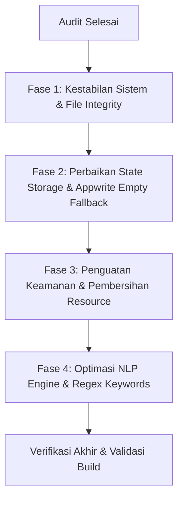

# Laporan Audit Komprehensif: Logika, Arsitektur, & Keamanan Backend ProjectVault

**Tanggal Audit:** 2026-10-25  
**Waktu:** 19:40 WIB  
**Auditor:** Antigravity AI Code Audit Engine  
**Cakupan Sistem:** Next.js Route Handlers (`app/api/**`), Python NLP Services (`api/**`), & Data Persistence Layer (`lib/**`)  
**Branch Terkait:** `feat/frontend` / `feat/backend-job-tracker`  
**Status Audit:** **Action Required** (Ditemukan 1 Critical, 4 High, 5 Medium, 2 Low)

---

## 1. Ringkasan Eksekutif (Executive Summary)

Audit independen terhadap logika backend **ProjectVault** (`tracker_job`) dilakukan untuk mengidentifikasi cacat logika (*logic flaws*), inkonsistensi data, kerentanan keamanan (*vulnerabilities*), dan potensi kegagalan saat sistem dijalankan pada lingkungan produksi (*production readiness*).

Secara umum, arsitektur dasar yang menggabungkan **Next.js Serverless Route Handlers**, **Python NLP Engine lokal**, dan **Appwrite Cloud BaaS** telah dirancang dengan visi modular yang baik. Namun, ditemukan beberapa **titik kerapuhan kritis** yang dapat menyebabkan:
1. **Kegagalan total (HTTP 500)** pada saat repositori di-deploy ke server baru atau di-clone karena ketergantungan pada berkas yang masuk ke `.gitignore`.
2. **Resureksi data lama (*data resurrection*)** ketika pengguna sengaja mengosongkan basis data Appwrite.
3. **Kebocoran penyimpanan (*disk bloat*)** dan ketiadaan pembatasan path (*path traversal*) pada endpoint upload dokumen.
4. **Inkonsistensi casing enum status** antara mesin Python dan frontend TypeScript yang merusak pemilihan dropdown.

### Matriks Klasifikasi Temuan

| No | ID Temuan | Komponen | Tingkat Keparahan | Status | Dampak Operasional |
| :--- | :--- | :--- | :--- | :--- | :--- |
| 1 | `AUD-CRIT-01` | `app/api/applications/sync` | **CRITICAL** | **Selesai** | Deployment failure; script dipindahkan ke `api/batch_parser.py` (terlacak Git) |
| 2 | `AUD-HIGH-01` | `lib/storage.ts` | **HIGH** | **Selesai** | Validasi diubah ke `remote !== null`; state kosong sah tidak lagi membangkitkan dummy |
| 3 | `AUD-HIGH-02` | `lib/storage.ts` | **HIGH** | **Selesai** | `originalId` dipertahankan saat migrasi local ke cloud; tidak ada lagi duplikasi item |
| 4 | `AUD-HIGH-03` | `app/api/applications/upload-parse` | **HIGH** | **Selesai** | Dibatasi secara ketat dengan whitelist direktori `data/` dan format `.pdf` |
| 5 | `AUD-HIGH-04` | `app/api/applications/upload-parse` | **HIGH** | **Selesai** | Blok `try ... finally { fs.unlinkSync }` membersihkan berkas temp PDF & limit 15MB |
| 6 | `AUD-MED-01` | `api/services/nlp_engine.py` | **MEDIUM** | **Selesai** | Status dinormalisasi ke casing konsisten `"applied"` pada engine & model Pydantic |
| 7 | `AUD-MED-02` | `api/config.py` | **MEDIUM** | **Selesai** | Disambiguasi kualifikasi `"golang"`, `"go language"`, dan context boundary pada `"r"` |
| 8 | `AUD-MED-03` | `app/api/applications/sync` | **MEDIUM** | **Selesai** | Loop sekuensial diganti batch concurrency (`CHUNK_SIZE = 5`) via `Promise.all` |
| 9 | `AUD-MED-04` | `api/services/analyzer.py` | **MEDIUM** | **Selesai** | Draf cover letter memiliki paragraf motivasi elegan saat daftar proyek kosong |
| 10 | `AUD-MED-05` | `api/services/nlp_engine.py` | **MEDIUM** | **Selesai** | Regex pembersih nama perusahaan digeneralisasi via `APPLICANT_NAME` & generic patterns |
| 11 | `AUD-LOW-01` | `api/models/resume.py` | **LOW** | **Selesai** | Atribut `cover_letter: Optional[str] = ""` ditambahkan ke model `ResumeItem` |
| 12 | `AUD-LOW-02` | `app/api/applications/sync & lib/appwrite.ts` | **LOW** | **Selesai** | Batas teks `cover_letter` diselaraskan dengan batas schema Appwrite (5000 karakter) |

---

## 2. Bedah Detail Temuan Audit & Analisis Risiko

---

### `AUD-CRIT-01`: Rute API Sinkronisasi Bergantung pada Berkas yang Diabaikan Git
* **Komponen:** [app/api/applications/sync/route.ts:L17](file:///c:/Users/MyBook%20Hype%20AMD/OneDrive/Documents/kerja/_code/tracker_job/app/api/applications/sync/route.ts#L17) dan [L175](file:///c:/Users/MyBook%20Hype%20AMD/OneDrive/Documents/kerja/_code/tracker_job/app/api/applications/sync/route.ts#L175)
* **Kategori:** *Architecture & Deployment Vulnerability*
* **Keparahan:** **CRITICAL**

#### Deskripsi Masalah
Rute API sinkronisasi lamaran memanggil skrip Python eksternal melalui child process:
```typescript
const parserScript = path.join(cwd, 'scratch', 'batch_parser.py');
```
Namun, pada berkas [.gitignore:L53](file:///c:/Users/MyBook%20Hype%20AMD/OneDrive/Documents/kerja/_code/tracker_job/.gitignore#L53), direktori `scratch/` secara eksplisit dikecualikan dari Git:
```gitignore
# Private Documents & User Data
prd.md
data/
/data/
scratch/
```

#### Skenario Kegagalan
1. Pengembang lain melakukan `git clone` repositori ini di mesin baru.
2. Aplikasi di-deploy ke Vercel, VPS, atau container Docker.
3. Direktori `scratch/` tidak terbawa ke build environment.
4. Ketika pengguna membuka halaman lamaran atau menekan tombol sinkronisasi, server mengeksekusi `python scratch/batch_parser.py`, yang langsung menghasilkan `FileNotFoundError`.
5. Rute API mengembalikan status **HTTP 500: Gagal menjalankan parser python**.

#### Solusi Perbaikan
Pindahkan seluruh logika parser batch mandiri ke dalam direktori resmi `api/` (misal: `api/batch_parser.py`) yang terlacak oleh version control, lalu perbarui path rujukan pada `route.ts`.

---

### `AUD-HIGH-01`: False Failure pada State Kosong (*Empty State Data Resurrection*)
* **Komponen:** [lib/storage.ts:L1809](file:///c:/Users/MyBook%20Hype%20AMD/OneDrive/Documents/kerja/_code/tracker_job/lib/storage.ts#L1809) dan [L1876](file:///c:/Users/MyBook%20Hype%20AMD/OneDrive/Documents/kerja/_code/tracker_job/lib/storage.ts#L1876)
* **Kategori:** *Data Consistency & State Management Bug*
* **Keparahan:** **HIGH**

#### Deskripsi Masalah
Fungsi pengambilan data lamaran dan proyek diimplementasikan sebagai berikut:
```typescript
export async function getApplications(): Promise<JobApplication[]> {
  const config = getAppwriteConfig();
  if (config.isEnabled) {
    const remote = await fetchApplicationsFromAppwrite();
    if (remote && remote.length > 0) return remote; // <-- BUG DI SINI
  }

  // Local storage fallback
  if (typeof window === 'undefined') return INITIAL_APPLICATIONS;
  // ... memuat INITIAL_APPLICATIONS ...
}
```

#### Skenario Kegagalan
1. Pengguna menghubungkan Appwrite Cloud.
2. Pengguna menghapus semua lamaran pekerjaan karena ingin memulai dari nol (*fresh state*).
3. Appwrite berhasil merespons dengan array dokumen kosong: `remote = []`.
4. Evaluasi `remote.length > 0` bernilai `false`.
5. Fungsi mengira koneksi Appwrite gagal dan **otomatis me-restore 91 berkas lamaran default (`INITIAL_APPLICATIONS`)** ke antarmuka pengguna!
6. Pengguna tidak akan pernah bisa memiliki basis data kosong.

#### Solusi Perbaikan
Ubah pengecekan agar membedakan antara *koneksi gagal* (`remote === null`) dengan *data kosong yang sah* (`remote.length === 0`):
```typescript
if (remote !== null) return remote;
```

---

### `AUD-HIGH-02`: Duplikasi Data Lokal Saat Sinkronisasi Cloud (*Orphaned Records*)
* **Komponen:** [lib/storage.ts:L1836-L1852](file:///c:/Users/MyBook%20Hype%20AMD/OneDrive/Documents/kerja/_code/tracker_job/lib/storage.ts#L1836-L1852) dan [L1903-L1919](file:///c:/Users/MyBook%20Hype%20AMD/OneDrive/Documents/kerja/_code/tracker_job/lib/storage.ts#L1903-L1919)
* **Kategori:** *Data Consistency Bug*
* **Keparahan:** **HIGH**

#### Deskripsi Masalah
Saat pengguna membuat entitas baru dalam mode offline atau sebelum tersambung, entitas diberi ID lokal: `local_app_1792...`. Ketika koneksi ke Appwrite aktif:
```typescript
const updatedApp = {
  ...appItem,
  id: appItem.id || `local_app_${Date.now()}`
};

if (config.isEnabled) {
  const remoteId = await saveApplicationToAppwrite(updatedApp);
  if (remoteId) {
    updatedApp.id = remoteId; // ID lokal ditimpa dengan ID Appwrite baru
  }
}

// Update local storage
if (typeof window !== 'undefined') {
  const current = await getApplications();
  const index = current.findIndex(a => a.id === updatedApp.id); // <-- TIDAK DITEMUKAN
  if (index >= 0) {
    current[index] = updatedApp;
  } else {
    current.unshift(updatedApp); // <-- MENAMBAH ENTITAS BARU
  }
  localStorage.setItem(STORAGE_KEYS.APPLICATIONS, JSON.stringify(current));
}
```

#### Skenario Kegagalan
1. Objek di lokal memiliki ID `local_app_123`.
2. Appwrite menyimpan dokumen dan mengembalikan ID `6adc6...`.
3. `updatedApp.id` berubah menjadi `6adc6...`.
4. Pencarian `current.findIndex(a => a.id === '6adc6...')` menghasilkan `-1` (karena di array `current`, item tersebut masih ber-ID `local_app_123`).
5. Kode mengeksekusi `current.unshift()`, sehingga di `localStorage` kini tersimpan **dua entitas identik**: satu dengan ID `local_app_123` dan satu dengan `6adc6...`.

#### Solusi Perbaikan
Catat `originalId = appItem.id` sebelum penimpaan, dan cari dengan klausa ganda:
```typescript
const originalId = appItem.id;
// ... setelah simpan Appwrite ...
const index = current.findIndex(a => a.id === updatedApp.id || (originalId && a.id === originalId));
```

---

### `AUD-HIGH-03`: Potensi Path Traversal pada Ingestion Berkas Lokal
* **Komponen:** [app/api/applications/upload-parse/route.ts:L88-L91](file:///c:/Users/MyBook%20Hype%20AMD/OneDrive/Documents/kerja/_code/tracker_job/app/api/applications/upload-parse/route.ts#L88-L91)
* **Kategori:** *Security / Input Validation*
* **Keparahan:** **HIGH**

#### Deskripsi Masalah
Endpoint `POST /api/applications/upload-parse` menerima parameter `localFilePath` dalam body JSON:
```typescript
const absolutePath = path.isAbsolute(localFilePath) 
  ? localFilePath 
  : path.join(cwd, localFilePath);

if (!fs.existsSync(absolutePath)) { ... }
const parsedData = await parsePdfWithPython(absolutePath, cwd);
```
Tidak ada validasi apakah `absolutePath` berada di dalam direktori kerja yang sah (*whitelisted boundary*).

#### Dampak Nyata
Permintaan dapat memasukkan path absolut sembarang (misalnya: `C:\Windows\System32\...` atau `../../.env.local`), yang kemudian dipaksa dibaca oleh parser dokumen, berpotensi memicu pembocoran isi berkas sensitif atau kegagalan tak terkendali.

#### Solusi Perbaikan
Terapkan kurungan direktori (*jail/containment*):
```typescript
const allowedBase = path.resolve(cwd, 'data');
const resolvedPath = path.resolve(cwd, localFilePath);

if (!resolvedPath.startsWith(allowedBase)) {
  return NextResponse.json(
    { success: false, error: 'Akses berkas di luar direktori data ditolak.' },
    { status: 403 }
  );
}
```

---

### `AUD-HIGH-04`: Kebocoran Penyimpanan Berkas Sementara (*Disk Leak / Bloat*)
* **Komponen:** [app/api/applications/upload-parse/route.ts:L127-L132](file:///c:/Users/MyBook%20Hype%20AMD/OneDrive/Documents/kerja/_code/tracker_job/app/api/applications/upload-parse/route.ts#L127-L132)
* **Kategori:** *Resource Management Bug*
* **Keparahan:** **HIGH**

#### Deskripsi Masalah
Ketika pengguna mengunggah berkas PDF melalui drag-and-drop:
```typescript
const targetPath = path.join(uploadDir, `${Date.now()}_${safeName}`);
fs.writeFileSync(targetPath, buffer);
const parsedData = await parsePdfWithPython(targetPath, cwd);
return NextResponse.json({ ... });
```
Berkas sementara tersebut disimpan ke `scratch/uploads/` dan **tidak pernah dihapus** setelah ekstraksi selesai.

#### Dampak Nyata
Setiap kali pengguna melakukan drag & drop atau menguji puluhan file, ruang disk server akan terus menyusut secara permanen hingga kehabisan kapasitas (*disk space exhaustion*).

#### Solusi Perbaikan
Tambahkan pembersihan otomatis dengan blok `finally`:
```typescript
try {
  const parsedData = await parsePdfWithPython(targetPath, cwd);
  return NextResponse.json({ success: true, data: parsedData });
} finally {
  if (fs.existsSync(targetPath)) {
    try { fs.unlinkSync(targetPath); } catch {}
  }
}
```

---

### `AUD-MED-01`: Inkonsistensi Casing Enum Status (`"Applied"` vs `"applied"`)
* **Komponen:** [api/services/nlp_engine.py:L173](file:///c:/Users/MyBook%20Hype%20AMD/OneDrive/Documents/kerja/_code/tracker_job/api/services/nlp_engine.py#L173) vs [lib/types.ts:L14](file:///c:/Users/MyBook%20Hype%20AMD/OneDrive/Documents/kerja/_code/tracker_job/lib/types.ts#L14)
* **Kategori:** *Data Integrity & UI Binding Defect*
* **Keparahan:** **MEDIUM**

#### Deskripsi Masalah
* Mesin Python `nlp_engine.py` mengembalikan:
  ```python
  "status": "Applied"  # Huruf Kapital A
  ```
* Definisi tipe TypeScript di frontend:
  ```typescript
  export type ApplicationStatus = 'wishlist' | 'applied' | 'interview' | 'offer' | 'rejected';
  ```
* Elemen form di modal:
  ```tsx
  <select value={status} onChange={e => setStatus(e.target.value as ApplicationStatus)}>
    <option value="applied">Terkirim (Applied)</option>
  ```

#### Dampak Nyata
Ketika hasil parse diisikan ke form via auto-fill, nilai `"Applied"` tidak cocok dengan nilai opsi `"applied"`. Akibatnya, elemen dropdown gagal memilih opsi yang sesuai atau kolom status pada Kanban board tidak menampilkan kartu pada kolom yang tepat.

---

### `AUD-MED-02`: False-Positive Kata Kunci Keahlian Karakter Tunggal
* **Komponen:** [api/config.py:L8](file:///c:/Users/MyBook%20Hype%20AMD/OneDrive/Documents/kerja/_code/tracker_job/api/config.py#L8) & [api/services/nlp_engine.py:L134-L137](file:///c:/Users/MyBook%20Hype%20AMD/OneDrive/Documents/kerja/_code/tracker_job/api/services/nlp_engine.py#L134-L137)
* **Kategori:** *NLP Accuracy Defect*
* **Keparahan:** **MEDIUM**

#### Deskripsi Masalah
Daftar `TECH_KEYWORDS` pada `config.py` memuat kata kunci berkarakter tunggal atau kata umum:
```python
"r", "go", "ai", "c"
```
Regex boundary yang digunakan:
```python
pat = r'(?<![a-zA-Z0-9_-])' + re.escape(skill) + r'(?![a-zA-Z0-9_-])'
```
Pada dokumen surat lamaran berbahasa Indonesia, huruf `"r"` sering muncul sebagai penomoran (misal: `point r.`), singkatan alamat (`No. 5 R`), atau singkatan divisi (`R&D`). Sementara kata `"go"` sering muncul dalam kalimat bahasa Inggris umum seperti `"go-to person"` atau `"let's go"`.

#### Dampak Nyata
Bahasa pemrograman **R** dan **Go** terdeteksi secara keliru (*false positive*) pada hampir setiap berkas surat lamaran umum, mendistorsi analitik keahlian kandidat.

---

### `AUD-MED-03`: Risiko Serverless Timeout pada Loop Fetch Sekuensial ke Cloud
* **Komponen:** [app/api/applications/sync/route.ts:L82-L130](file:///c:/Users/MyBook%20Hype%20AMD/OneDrive/Documents/kerja/_code/tracker_job/app/api/applications/sync/route.ts#L82-L130)
* **Kategori:** *Performance & Scalability Defect*
* **Keparahan:** **MEDIUM**

#### Deskripsi Masalah
Ketika menyinkronkan 91 berkas lamaran ke Appwrite Cloud di region Singapura (`sgp.cloud.appwrite.io`), kode menjalankan perulangan `for` dengan `await fetch(...)` satu per satu secara berurutan.

#### Dampak Nyata
Dengan rata-rata latensi round-trip jaringan 150-250ms per permintaan HTTP:
$$\text{Total Waktu} \approx 91 \times 200\text{ ms} = 18.2\text{ detik}$$
Pada lingkungan hosting seperti Vercel Serverless (yang memiliki batas eksekusi maksimum 10-15 detik untuk paket gratis/standar), permintaan ini akan **mengalami pemutusan paksa HTTP 504 Gateway Timeout**.

---

### `AUD-MED-04`: Format Draf Cover Letter Kosong Saat Proyek Belum Ada
* **Komponen:** [api/services/analyzer.py:L89-L135](file:///c:/Users/MyBook%20Hype%20AMD/OneDrive/Documents/kerja/_code/tracker_job/api/services/analyzer.py#L89-L135)
* **Kategori:** *Logic Fallback Defect*
* **Keparahan:** **MEDIUM**

#### Deskripsi Masalah
Fungsi `generate_cover_letter` membuat bagian proyek terkait dengan:
```python
proj_bullets = []
for mp in top_projects[:3]:
    # format bullet...
proj_section = "\n\n".join(proj_bullets)
```
Jika kandidat adalah pengguna baru yang belum mencatatkan portofolio pada sistem (`projects = []`), variabel `proj_section` menjadi string kosong. Hasil surat lamaran menjadi:
```
Berikut beberapa proyek terkait yang membuktikan kompetensi saya:


Dengan latar belakang pengalaman praktis tersebut...
```
Terdapat ruang kosong ganjil tanpa paragraf pengganti (*graceful degradation*).

---

## 3. Rencana Aksi Perbaikan Terjadwal (Remediation Roadmap)



### Fase 1: Kestabilan Sistem & File Integrity (Prioritas Utama)
1. **Migrasi Parser Script**: Salin `scratch/batch_parser.py` ke [api/batch_parser.py](file:///c:/Users/MyBook%20Hype%20AMD/OneDrive/Documents/kerja/_code/tracker_job/api/batch_parser.py) dan perbarui [app/api/applications/sync/route.ts](file:///c:/Users/MyBook%20Hype%20AMD/OneDrive/Documents/kerja/_code/tracker_job/app/api/applications/sync/route.ts).
2. **Normalisasi Status**: Ubah nilai status pada [api/services/nlp_engine.py](file:///c:/Users/MyBook%20Hype%20AMD/OneDrive/Documents/kerja/_code/tracker_job/api/services/nlp_engine.py) menjadi `"status": "applied"`.

### Fase 2: Perbaikan State Storage & Appwrite
1. **Perbaikan Empty State Check**: Di [lib/storage.ts](file:///c:/Users/MyBook%20Hype%20AMD/OneDrive/Documents/kerja/_code/tracker_job/lib/storage.ts), ganti `if (remote && remote.length > 0)` menjadi `if (remote !== null)`.
2. **Pencegahan Duplikasi ID**: Pertahankan referensi ID awal sebelum migrasi remote pada fungsi `saveProject` dan `saveApplication`.

### Fase 3: Keamanan & Pembersihan Resource
1. **Sanitasi Path Traversal**: Tambahkan pemeriksaan `startsWith(allowedDir)` pada rute [app/api/applications/upload-parse/route.ts](file:///c:/Users/MyBook%20Hype%20AMD/OneDrive/Documents/kerja/_code/tracker_job/app/api/applications/upload-parse/route.ts).
2. **Auto-Cleanup Upload PDF**: Tambahkan `fs.unlinkSync` dalam blok `finally` setelah proses parsing selesai.
3. **Pembatasan Ukuran Upload**: Tolak berkas di atas batas wajar (misal: 15 MB).

### Fase 4: Optimasi Akurasi NLP & Jaringan
1. **Penyempurnaan Kata Kunci**: Sesuaikan kata kunci berisiko tinggi (`"r"`, `"go"`) di [api/config.py](file:///c:/Users/MyBook%20Hype%20AMD/OneDrive/Documents/kerja/_code/tracker_job/api/config.py).
2. **Chunked Concurrency**: Terapkan batching (5-10 concurrent requests) untuk sinkronisasi Appwrite agar terhindar dari batas timeout 15 detik.
3. **Penyempurnaan Model Pydantic**: Tambahkan kolom `cover_letter: Optional[str] = ""` pada [api/models/resume.py](file:///c:/Users/MyBook%20Hype%20AMD/OneDrive/Documents/kerja/_code/tracker_job/api/models/resume.py).

---

*Laporan ini disimpan secara permanen pada direktori dokumentasi arsitektur proyek untuk pelacakan perbaikan berkelanjutan.*
