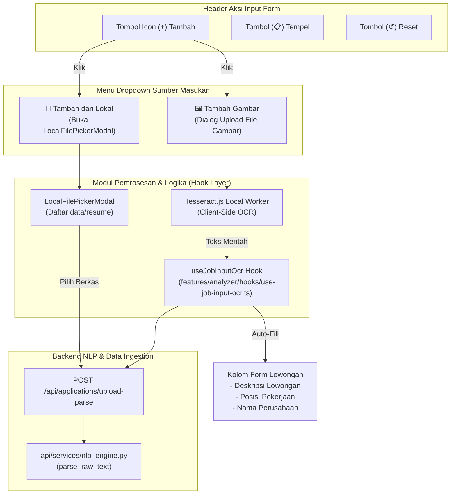

# Changelog: Tombol Aksi Tambah (+) untuk Ekstraksi Gambar OCR & Pemuat Berkas Dokumen Lokal

**Tanggal:** 2026-10-27  
**Waktu:** 17:40 WIB  
**Branch:** `feat/backend`  
**Nama Commit:** `feat(backend): add plus icon button menu for image ocr and local file ingestion` (`10-27-2026-17-40-feat-backend-plus-button-image-ocr-and-local-file-picker`)  
**Tipe Perubahan:** `feat` (Interactive Quick Actions, Client-side OCR Integration, Local Document Ingestion, Clean Architecture Decomposition)

---

## 1. Ringkasan Perubahan (Executive Summary)

Pembaruan pada branch `feat/backend` ini melengkapi antarmuka masukan teks pada fitur **AI & Analisis** (`/analyzer`) dan **Modal Catat Lamaran** (`features/applications`) dengan tombol aksi cepat **`+` (Tambah)** yang terletak berdampingan dengan tombol **"Tempel"** (*paste*) dan **"Reset"**.

### Kebutuhan Pengguna:
Sebelumnya, pada panel formulir lowongan hanya tersedia tombol tempel teks biasa dari *clipboard*. Pengguna yang memiliki bukti lowongan dalam bentuk **tangkapan layar (screenshot)** atau ingin menganalisis ulang dokumen surat lamaran yang sudah tersimpan di direktori lokal (`data/resume`) harus membuka berkas secara terpisah dan menyalin teks secara manual.

### Solusi yang Diimplementasikan:
1. **Tombol Interaktif `+` (Tambah) dengan Menu Dropdown Glassmorphic:**
   - Ditempatkan di samping tombol "Tempel".
   - Dilengkapi animasi rotasi 45 derajat saat menu aktif serta penutupan otomatis saat pengguna mengklik di luar area (*click-outside listener*).
2. **Opsi 1 — 🖼️ Tambah Gambar (OCR Lokal):**
   - Pengguna memilih berkas gambar (`.png`, `.jpg`, `.jpeg`, `.webp`) atau tangkapan layar lowongan kerja.
   - Modul `tesseract.js` memproses OCR langsung di peramban secara offline tanpa API eksternal.
   - Teks yang terekstrak otomatis diisikan ke kolom deskripsi lowongan, dan secara otomatis mendeteksi nama **Perusahaan** dan **Posisi Pekerjaan** via *local NLP engine*.
3. **Opsi 2 — 📂 Tambah dari Berkas Lokal (`data/resume`):**
   - Membuka modal pemilih berkas [LocalFilePickerModal.tsx](file:///c:/Users/MyBook%20Hype%20AMD/OneDrive/Documents/kerja/_code/tracker_job/features/analyzer/components/LocalFilePickerModal.tsx).
   - Menampilkan daftar puluhan berkas surat lamaran/CV lokal lengkap dengan kolom pencarian instan nama berkas/perusahaan.
   - Sekali klik, teks surat lamaran termuat otomatis ke form input untuk langsung dianalisis kecocokannya dengan proyek portofolio.
4. **Ketersediaan Menyeluruh:**
   - Hadir pada halaman **AI & Analisis** ([JobInputCard.tsx](file:///c:/Users/MyBook%20Hype%20AMD/OneDrive/Documents/kerja/_code/tracker_job/features/analyzer/components/JobInputCard.tsx)).
   - Hadir pada panel input teks panjang **Modal Lamaran Kerja** ([RawTextParserTab.tsx](file:///c:/Users/MyBook%20Hype%20AMD/OneDrive/Documents/kerja/_code/tracker_job/features/applications/components/ApplicationModal/RawTextParserTab.tsx)).

---

## 2. Diagram Alur Arsitektur & Interaksi Komponen



---

## 3. Rincian Modifikasi & Berkas Baru

| Berkas | Tipe | Ukuran | Deskripsi |
| :--- | :---: | :---: | :--- |
| [features/analyzer/components/JobInputMediaMenu.tsx](file:///c:/Users/MyBook%20Hype%20AMD/OneDrive/Documents/kerja/_code/tracker_job/features/analyzer/components/JobInputMediaMenu.tsx) | `new` | **180 baris** | Komponen menu aksi yang memuat tombol icon `+`, dropdown menu glassmorphic untuk Tambah Gambar dan Tambah dari Lokal, serta tombol Tempel dan Reset. |
| [features/analyzer/hooks/use-job-input-ocr.ts](file:///c:/Users/MyBook%20Hype%20AMD/OneDrive/Documents/kerja/_code/tracker_job/features/analyzer/hooks/use-job-input-ocr.ts) | `new` | **122 baris** | Custom hook yang mengisolasi state pemrosesan OCR Tesseract, status progres real-time, dan pemanggilan API parsing entitas. |
| [features/analyzer/components/LocalFilePickerModal.tsx](file:///c:/Users/MyBook%20Hype%20AMD/OneDrive/Documents/kerja/_code/tracker_job/features/analyzer/components/LocalFilePickerModal.tsx) | `new` | **132 baris** | Modal pencarian berkas lokal di direktori `data/resume` dengan fitur filter pencarian teks dan preview ukuran berkas. |
| [features/analyzer/components/JobInputCard.tsx](file:///c:/Users/MyBook%20Hype%20AMD/OneDrive/Documents/kerja/_code/tracker_job/features/analyzer/components/JobInputCard.tsx) | `modified` | **212 baris** | Mengintegrasikan `JobInputMediaMenu` ke header form lowongan kerja dan menghapus logika clipboard inline (reduksi baris kode). |
| [features/applications/components/ApplicationModal/RawTextParserTab.tsx](file:///c:/Users/MyBook%20Hype%20AMD/OneDrive/Documents/kerja/_code/tracker_job/features/applications/components/ApplicationModal/RawTextParserTab.tsx) | `modified` | **219 baris** | Mengintegrasikan tombol `+` dengan `useJobInputOcr` pada tab teks panjang modal lamaran kerja. |

---

## 4. Statistik Perubahan Baris Kode (Git Diff Stats)

```text
 features/analyzer/components/JobInputCard.tsx                     |  40 ++-----
 features/applications/components/ApplicationModal/RawTextParserTab.tsx | 125 ++++++++++++++++++++-
 features/analyzer/components/JobInputMediaMenu.tsx                | 180 baris baru
 features/analyzer/components/LocalFilePickerModal.tsx             | 132 baris baru
 features/analyzer/hooks/use-job-input-ocr.ts                      | 122 baris baru
 2 files modified, 3 files created
 Total insertions(+): 564, Total deletions(-): 35
```

---

## 5. Hasil Pengujian & Jaminan Mutu (Verification & QA)

1. **Kepatuhan Aturan Batas Baris Kode (*Bulk Lines Policy*)**:
   - Seluruh 5 berkas diverifikasi memiliki ukuran **< 220 baris**, memenuhi batas maksimal basis kode (< 250 baris per berkas):
     - `JobInputCard.tsx`: 212 baris
     - `RawTextParserTab.tsx`: 219 baris
     - `JobInputMediaMenu.tsx`: 180 baris
     - `LocalFilePickerModal.tsx`: 132 baris
     - `use-job-input-ocr.ts`: 122 baris
2. **Pemeriksaan Tipe TypeScript (`npx tsc --noEmit`)**:
   - Lulus 100% tanpa kesalahan tipe (*0 errors, exit code: 0*).
3. **Build Produksi Next.js (`npm run build`)**:
   - Seluruh rute statis (`/`, `/analyzer`, `/applications`, `/projects`, `/settings`) dan rute dinamis API berhasil dikompilasi secara optimal (*exit code: 0*).
