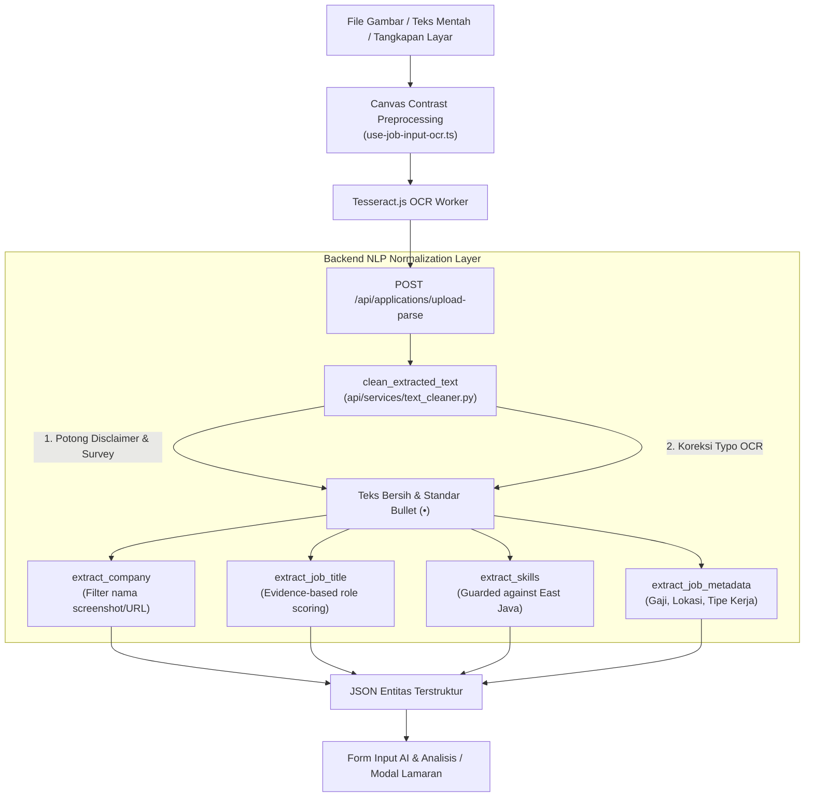

# Changelog: Peningkatan Akurasi Parsing NLP, Sanitasi Disclaimer Formulir & Preprocessing Kontras Gambar OCR

**Tanggal:** 2026-10-27  
**Waktu:** 18:30 WIB  
**Branch:** `feat/backend`  
**Nama Commit:** `feat(backend): improve nlp parsing accuracy, form disclaimer cleaning, and ocr image contrast preprocessing` (`10-27-2026-18-30-feat-backend-nlp-parsing-accuracy-and-ocr-image-preprocessing`)  
**Tipe Perubahan:** `feat` / `fix` (NLP Entity Extraction Accuracy, Geographical False-Positive Elimination, Form Boilerplate Sanitization, Client-side Canvas Contrast Preprocessing)

---

## 1. Ringkasan Perubahan (Executive Summary)

Pembaruan ini menuntaskan permasalahan inkonsistensi dan ketidakakuratan parsing ekstraksi entitas NLP pada teks masukan formulir lowongan kerja (terutama dari hasil *screenshot* Microsoft Forms / Google Forms / tangkapan layar peramban).

### Permasalahan yang Ditemukan:
1. **Nama Perusahaan Rusak**: Nama berkas *screenshot* panjang peramban (contoh: `screencapture-forms-cloud-microsoft-pages-responsepage-aspx-2026-10-26-14_37_39`) tidak difilter dan dianggap sebagai nama perusahaan.
2. **Posisi Pekerjaan Meleset ke Generic Fallback**: Posisi lowongan jatuh ke default `"Software Engineer"`, padahal teks lowongan memuat tanggung jawab dan kualifikasi backend yang sangat dominan.
3. **False Positive Skill Java dari Wilayah Geografis**: `"Surabaya, East Java"` memicu terdeteksinya keahlian bahasa pemrograman `java`.
4. **Keahlian Penting Tidak Terdeteksi**: Varian OCR seperti `Node js` (tanpa titik), `(Cl/Laravel` (huruf 'l' kecil pengganti 'I'), `OOP`, dan `Yii` tidak terpetakan ke taksonomi.
5. **Polusi Teks Disclaimer & Tombol Formulir**: Teks deskripsi lowongan tercampur dengan tombol navigasi *Back/Next*, pertanyaan formulir pelamar, dan disclaimer Microsoft 365 / *Report abuse*.
6. **Teks Berwarna Hilang pada OCR**: Teks judul lowongan berwarna oranye (*Back-End Developer*) pada kartu putih sering terhapus saat binarisasi standar Tesseract.
7. **Metadata Gaji & Lokasi Belum Terekstrak**: Informasi lokasi kerja, tipe kerja (WFO/WFH), dan rentang gaji belum tersimpan dalam format terstruktur.

### Solusi yang Diimplementasikan:
1. **Modul Sanitasi & Pembersih Teks Dedikasi ([text_cleaner.py](file:///c:/Users/MyBook%20Hype%20AMD/OneDrive/Documents/kerja/_code/tracker_job/api/services/text_cleaner.py))**:
   - Mendeteksi dan memvalidasi *hint* berkas tangkapan layar (`is_generic_or_screenshot_hint`) dengan menyaring URL, hash, `.aspx`, `.php`, dan token `screencapture`.
   - Menghapus otomatis disclaimer formulir (*Microsoft Forms*, *Report abuse*, *Privacy*, pertanyaan kuesioner pelamar).
   - Menstandarkan bullet point (`•`) dari karakter OCR acak (`e`, `«`, `— e`, `) e`, `*`) serta mengoreksi typo OCR umum (`Cl/Laravel` ➔ `CI/Laravel`, `unigue` ➔ `unique`, `guality` ➔ `quality`).
2. **Evidence-based Role Inference pada NLP Engine ([nlp_engine.py](file:///c:/Users/MyBook%20Hype%20AMD/OneDrive/Documents/kerja/_code/tracker_job/api/services/nlp_engine.py))**:
   - Jika judul pekerjaan eksplisit tidak ditemukan di baris pertama, sistem menghitung bobot bukti kontekstual (*scoring evidence*) dari tanggung jawab pekerjaan dan kualifikasi stack (misal `application's backend`, `PHP`, `Node.js`, `SQL`, `MySQL` ➔ otomatis menghasilkan `"Backend Developer"`).
3. **Proteksi False-Positive Geografis**:
   - Kata `java` yang didahului frasa lokasi (`East Java`, `West Java`, `Central Java`, `Pulau Jawa`, `Jawa Timur`) tidak lagi memicu bahasa pemrograman Java.
4. **Ekspansi Taksonomi & Sinonim ([config.py](file:///c:/Users/MyBook%20Hype%20AMD/OneDrive/Documents/kerja/_code/tracker_job/api/config.py))**:
   - Menambahkan portal `Microsoft Forms` dan `Google Forms`.
   - Menambahkan dan memetakan sinonim `node js` ➔ `node.js`, `ci` ➔ `codeigniter`, `oop`, `data structure`, dan `data workflow`.
5. **Ekstraksi Metadata Terstruktur & Schema Resume ([resume.py](file:///c:/Users/MyBook%20Hype%20AMD/OneDrive/Documents/kerja/_code/tracker_job/api/models/resume.py))**:
   - Ekstraksi otomatis `location` (`Surabaya, East Java`), `job_type` (`Full time - WFO`), dan `salary_range` (`IDR 4.500.000 — IDR 6.500.000 per month`).
6. **Canvas Color Contrast Preprocessing ([use-job-input-ocr.ts](file:///c:/Users/MyBook%20Hype%20AMD/OneDrive/Documents/kerja/_code/tracker_job/features/analyzer/hooks/use-job-input-ocr.ts))**:
   - Preprocessing gambar berbasis canvas HTML5 yang menggelapkan teks berwarna (oranye, merah, biru) terhadap latar belakang putih sebelum diproses Tesseract OCR agar tidak hilang.

---

## 2. Diagram Alur Pemrosesan Teks & Sanitasi Entitas



---

## 3. Rincian Modifikasi & Berkas Baru

| Berkas | Tipe | Ukuran | Deskripsi |
| :--- | :---: | :---: | :--- |
| [api/services/text_cleaner.py](file:///c:/Users/MyBook%20Hype%20AMD/OneDrive/Documents/kerja/_code/tracker_job/api/services/text_cleaner.py) | `new` | **73 baris** | Modul modular untuk memfilter hint screenshot/URL dan membersihkan disclaimer form, noise OCR, serta typo teknis. |
| [api/services/nlp_engine.py](file:///c:/Users/MyBook%20Hype%20AMD/OneDrive/Documents/kerja/_code/tracker_job/api/services/nlp_engine.py) | `modified` | **232 baris** | Implementasi evidence scoring untuk inferensi role pekerjaan, proteksi false positive geografi Jawa, dan ekstraksi metadata gaji/lokasi. |
| [api/config.py](file:///c:/Users/MyBook%20Hype%20AMD/OneDrive/Documents/kerja/_code/tracker_job/api/config.py) | `modified` | **105 baris** | Penambahan portal Microsoft/Google Forms, keyword `node js`, `ci`, `codeigniter`, `yii`, `oop`, dan sinonim normalisasi. |
| [api/models/resume.py](file:///c:/Users/MyBook%20Hype%20AMD/OneDrive/Documents/kerja/_code/tracker_job/api/models/resume.py) | `modified` | **30 baris** | Penambahan field opsional `location`, `salary_range`, dan `job_type` pada model `ResumeItem`. |
| [api/parse_single.py](file:///c:/Users/MyBook%20Hype%20AMD/OneDrive/Documents/kerja/_code/tracker_job/api/parse_single.py) | `modified` | **57 baris** | Penambahan opsi `--file-text` untuk membaca dan mem-parse teks file secara aman via CLI. |
| [app/api/applications/upload-parse/route.ts](file:///c:/Users/MyBook%20Hype%20AMD/OneDrive/Documents/kerja/_code/tracker_job/app/api/applications/upload-parse/route.ts) | `modified` | **248 baris** | Menggunakan argumen CLI `--file-text` untuk mengeksekusi parsing tanpa risiko string escaping di shell Windows. |
| [features/analyzer/hooks/use-job-input-ocr.ts](file:///c:/Users/MyBook%20Hype%20AMD/OneDrive/Documents/kerja/_code/tracker_job/features/analyzer/hooks/use-job-input-ocr.ts) | `modified` | **162 baris** | Menambahkan `preprocessImageForOcr` berbasis canvas untuk kontras teks berwarna dan auto-fill teks bersih hasil backend NLP. |
| [features/applications/components/ApplicationModal/use-resume-parser.ts](file:///c:/Users/MyBook%20Hype%20AMD/OneDrive/Documents/kerja/_code/tracker_job/features/applications/components/ApplicationModal/use-resume-parser.ts) | `modified` | **215 baris** | Menambahkan sanitasi hint screenshot agar tidak mengotori nama sumber atau entitas perusahaan. |

---

## 4. Statistik Perubahan Baris Kode (Git Diff Stats)

```text
 api/config.py                                      |  17 ++-
 api/models/resume.py                               |   3 +
 api/parse_single.py                                |  13 ++
 api/services/nlp_engine.py                         | 136 ++++++++++++---------
 api/services/text_cleaner.py                       |  73 baris baru
 app/api/applications/upload-parse/route.ts         |   5 +-
 features/analyzer/hooks/use-job-input-ocr.ts       |  96 +++++++++++----
 features/applications/components/ApplicationModal/use-resume-parser.ts | 6 +-
 8 files changed, 259 insertions(+), 90 deletions(-)
```

---

## 5. Hasil Pengujian & Jaminan Mutu (Verification & QA)

1. **Kepatuhan Aturan Batas Baris Kode (*Bulk Lines Policy*)**:
   - Seluruh 8 berkas diverifikasi memiliki ukuran **< 250 baris**:
     - `text_cleaner.py`: 73 baris
     - `nlp_engine.py`: 232 baris
     - `config.py`: 105 baris
     - `resume.py`: 30 baris
     - `parse_single.py`: 57 baris
     - `upload-parse/route.ts`: 248 baris
     - `use-job-input-ocr.ts`: 162 baris
     - `use-resume-parser.ts`: 215 baris
2. **Kompilasi Python (`py_compile`)**:
   - Lulus 100% pada semua berkas dalam paket `api/**/*.py` (*0 errors, exit code: 0*).
3. **Pemeriksaan Tipe TypeScript (`npx tsc --noEmit`)**:
   - Lulus 100% tanpa kesalahan tipe (*0 errors, exit code: 0*).
4. **Build Produksi Next.js (`npm run build`)**:
   - Seluruh rute statis dan rute dinamis API berhasil dikompilasi secara optimal (*exit code: 0*).
