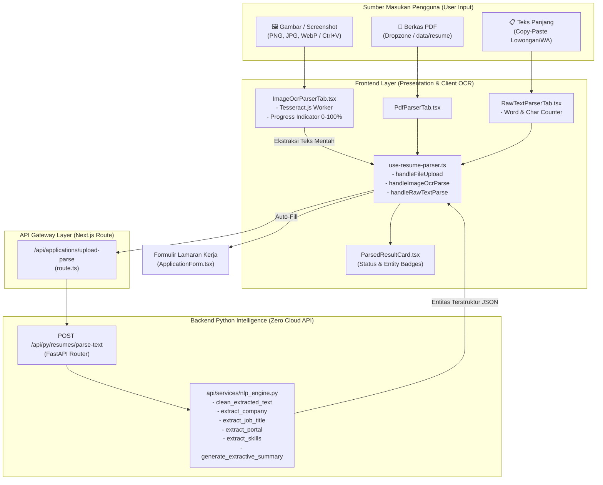

# Changelog: Integrasi Ekstraksi Gambar (OCR) & Parsing Teks Panjang NLP untuk Dokumen dan Lowongan Kerja

**Tanggal:** 2026-10-27  
**Waktu:** 10:35 WIB  
**Branch:** `feat/backend-ai-analysis`  
**Nama Commit:** `feat(backend/ai_analysis): add image ocr parsing and raw long text nlp extraction` (`10-27-2026-10-35-feat-backend-ai-analysis-image-ocr-and-long-text-nlp-parsing`)  
**Tipe Perubahan:** `feat` (Image OCR Vision Extraction, Long Text NLP Parsing, Modular 3-Tab Ingestion Architecture, Zero Cloud API)

---

## 1. Ringkasan Perubahan (Executive Summary)

Pembaruan pada branch `feat/backend-ai-analysis` ini menghadirkan dua kapabilitas ekstraksi dokumen tingkat lanjut pada antarmuka pencatatan lamaran kerja (**Application Modal / AI Ingestion**):

1. **Parse dari Salinan Teks Panjang (*Raw Long Text NLP Extraction*):**
   - Mengatasi limitasi sebelumnya di mana sistem hanya menerima berkas `.pdf`.
   - Pengguna kini dapat langsung menempelkan (*paste*) deskripsi lowongan kerja panjang, pesan tawaran dari rekruter di LinkedIn/WhatsApp, maupun draf surat lamaran kerja ke dalam area teks.
   - Mesin NLP lokal Python mengekstrak secara instan:
     - Nama Perusahaan (`company_name`, misal: PT, CV, Studio, Technologies).
     - Posisi Pekerjaan (`job_title`, misal: Senior Frontend Developer, Full Stack Engineer).
     - Tanggal Lamaran / Posting (`applied_date`).
     - Portal Sumber Lowongan (`source_portal`, klasifikasi otomatis LinkedIn, Jobstreet, Glints, Kalibrr, Direct).
     - Keahlian Teknis Utama (`key_skills`, taksonomi multi-domain).
     - Ringkasan Ekstraktif AI (`summary`) dan Surat Lamaran (`cover_letter`).
     - Mengisi seluruh kolom formulir secara otomatis.

2. **Parse dari Gambar & Tangkapan Layar (*Local Image OCR Extraction*):**
   - Mendukung berkas gambar `.png`, `.jpg`, `.jpeg`, dan `.webp`.
   - Mendukung aksi **Drag & Drop**, pemilihan berkas dari komputer, serta **Tempel Tangkapan Layar Langsung dari Clipboard (`Ctrl+V`)** sesaat setelah mengambil tangkapan layar via *Snipping Tool* atau *Print Screen*.
   - Mesin OCR lokal (`tesseract.js`) berjalan 100% di browser (*client-side WebAssembly*) secara offline tanpa membebani server, dilengkapi visualisasi *progress bar* dan indikator status interaktif (0–100%).
   - Teks yang terbaca otomatis dialirkan ke mesin Python NLP untuk ekstraksi entitas dan pengisian formulir.

3. **Konsolidasi Arsitektur Bersih & Modular 3-Tab:**
   - Komponen raksasa `ApplicationParserPanel.tsx` didekomposisi menjadi 4 sub-komponen terisolasi yang masing-masing berukuran ringkas (< 185 baris), mematuhi prinsip *Single Responsibility Principle* (SRP) dan batas maksimal toleransi basis kode (< 250 baris per berkas).

---

## 2. Diagram Alur Arsitektur Ekstraksi Dokumen



---

## 3. Rincian Modifikasi per Komponen

| Komponen | Berkas | Tipe | Deskripsi Perubahan |
| :--- | :--- | :---: | :--- |
| **Backend Models** | [api/models/resume.py](file:///c:/Users/MyBook%20Hype%20AMD/OneDrive/Documents/kerja/_code/tracker_job/api/models/resume.py) | `modified` | Menambahkan skema model Pydantic `ParseRawTextRequest` dengan atribut `text` dan `source_hint`. |
| **Backend Service** | [api/services/nlp_engine.py](file:///c:/Users/MyBook%20Hype%20AMD/OneDrive/Documents/kerja/_code/tracker_job/api/services/nlp_engine.py) | `modified` | Menambahkan fungsi inti `parse_raw_text()`, merefaktor `parse_pdf_document()` untuk *reusability* (DRY), dan menyempurnakan batasan regex pengenal nama perusahaan (PT/CV) dari teks mentah. |
| **Backend Routers** | [api/routers/resumes.py](file:///c:/Users/MyBook%20Hype%20AMD/OneDrive/Documents/kerja/_code/tracker_job/api/routers/resumes.py) | `modified` | Menambahkan endpoint API baru `POST /api/py/resumes/parse-text` untuk mengekstrak entitas langsung dari teks mentah. |
| **Backend Shim** | [api/nlp_engine.py](file:///c:/Users/MyBook%20Hype%20AMD/OneDrive/Documents/kerja/_code/tracker_job/api/nlp_engine.py) | `modified` | Mengekspor fungsi `parse_raw_text` pada berkas barrel untuk kompatibilitas impor. |
| **Backend CLI** | [api/parse_single.py](file:///c:/Users/MyBook%20Hype%20AMD/OneDrive/Documents/kerja/_code/tracker_job/api/parse_single.py) | `modified` | Menambahkan parameter CLI `--text` agar dapat memproses pengujian teks langsung dari terminal/command prompt. |
| **Next.js Gateway** | [app/api/applications/upload-parse/route.ts](file:///c:/Users/MyBook%20Hype%20AMD/OneDrive/Documents/kerja/_code/tracker_job/app/api/applications/upload-parse/route.ts) | `modified` | Menambahkan fungsi pembantu `parseRawTextWithPython()` dan penanganan payload JSON `{ rawText: string, sourceHint?: string }` dengan fallback terpadu. |
| **Custom Hook** | [features/applications/components/ApplicationModal/use-resume-parser.ts](file:///c:/Users/MyBook%20Hype%20AMD/OneDrive/Documents/kerja/_code/tracker_job/features/applications/components/ApplicationModal/use-resume-parser.ts) | `modified` | Menambahkan handler `handleRawTextParse`, `handleImageOcrParse` berbasis `tesseract.js` dinamis, serta state progres `ocrProgress` dan `ocrStatus`. |
| **Type Definitions** | [features/applications/components/ApplicationModal/types.ts](file:///c:/Users/MyBook%20Hype%20AMD/OneDrive/Documents/kerja/_code/tracker_job/features/applications/components/ApplicationModal/types.ts) | `modified` | Memperluas antarmuka `ApplicationParserPanelProps` dengan parameter callback OCR dan teks mentah. |
| **Modal Container** | [features/applications/components/ApplicationModal/index.tsx](file:///c:/Users/MyBook%20Hype%20AMD/OneDrive/Documents/kerja/_code/tracker_job/features/applications/components/ApplicationModal/index.tsx) | `modified` | Menghubungkan fungsi baru dari `useResumeParser` ke komponen panel parser. |
| **Parser Orchestrator** | [features/applications/components/ApplicationModal/ApplicationParserPanel.tsx](file:///c:/Users/MyBook%20Hype%20AMD/OneDrive/Documents/kerja/_code/tracker_job/features/applications/components/ApplicationModal/ApplicationParserPanel.tsx) | `modified` | Merestrukturisasi panel menjadi 3 tab interaktif (*Berkas PDF*, *Gambar / OCR*, *Teks Panjang*) dengan kontrol segmentasi modern (167 baris). |
| **Sub-Tab PDF** | [features/applications/components/ApplicationModal/PdfParserTab.tsx](file:///c:/Users/MyBook%20Hype%20AMD/OneDrive/Documents/kerja/_code/tracker_job/features/applications/components/ApplicationModal/PdfParserTab.tsx) | `new` | Mengisolasi UI drag & drop berkas PDF dan pemilih berkas lokal dari direktori `data/resume` (141 baris). |
| **Sub-Tab Image OCR** | [features/applications/components/ApplicationModal/ImageOcrParserTab.tsx](file:///c:/Users/MyBook%20Hype%20AMD/OneDrive/Documents/kerja/_code/tracker_job/features/applications/components/ApplicationModal/ImageOcrParserTab.tsx) | `new` | Mengisolasi UI dropzone gambar, event listener `Ctrl+V` paste tangkapan layar, dan meteran progres OCR (182 baris). |
| **Sub-Tab Raw Text** | [features/applications/components/ApplicationModal/RawTextParserTab.tsx](file:///c:/Users/MyBook%20Hype%20AMD/OneDrive/Documents/kerja/_code/tracker_job/features/applications/components/ApplicationModal/RawTextParserTab.tsx) | `new` | Mengisolasi textarea teks panjang dengan fitur tempel cepat clipboard dan penghitung statistik kata/karakter (100 baris). |
| **Result Card** | [features/applications/components/ApplicationModal/ParsedResultCard.tsx](file:///c:/Users/MyBook%20Hype%20AMD/OneDrive/Documents/kerja/_code/tracker_job/features/applications/components/ApplicationModal/ParsedResultCard.tsx) | `new` | Mengisolasi kartu pratinjau entitas hasil ekstraksi AI dan chips keahlian teknis (74 baris). |
| **Dependencies** | [package.json](file:///c:/Users/MyBook%20Hype%20AMD/OneDrive/Documents/kerja/_code/tracker_job/package.json) & [package-lock.json](file:///c:/Users/MyBook%20Hype%20AMD/OneDrive/Documents/kerja/_code/tracker_job/package-lock.json) | `modified` | Menambahkan dependensi `tesseract.js` (^7.0.0) untuk mesin OCR lokal client-side. |

---

## 4. Statistik Perubahan Baris Kode (Git Diff Stats)

```text
 api/models/resume.py                               |   5 +
 api/nlp_engine.py                                  |   2 +
 api/parse_single.py                                |  16 +-
 api/routers/resumes.py                             |  23 +-
 api/services/nlp_engine.py                         |  48 ++--
 app/api/applications/upload-parse/route.ts         |  57 ++++-
 .../ApplicationModal/ApplicationParserPanel.tsx    | 275 +++++++--------------
 .../components/ApplicationModal/index.tsx          |   8 +
 .../components/ApplicationModal/types.ts           |   5 +
 .../ApplicationModal/use-resume-parser.ts          |  77 +++++-
 package-lock.json                                  | 117 ++++++++-
 package.json                                       |   3 +-
 features/applications/components/ApplicationModal/ImageOcrParserTab.tsx (182 baris baru)
 features/applications/components/ApplicationModal/ParsedResultCard.tsx  (74 baris baru)
 features/applications/components/ApplicationModal/PdfParserTab.tsx      (141 baris baru)
 features/applications/components/ApplicationModal/RawTextParserTab.tsx  (100 baris baru)
```

---

## 5. Hasil Pengujian & Jaminan Mutu (Verification & QA)

1. **Uji Ekstraksi NLP Teks Mentah (CLI & API)**:
   - Menjalankan perintah pengujian:
     ```bash
     .venv\Scripts\python.exe api/parse_single.py --text "Kepada Yth. HRD PT Solusi Digital Nusantara. Melamar posisi Senior Backend Developer di Jakarta via LinkedIn. Tech stack: Python, FastAPI, PostgreSQL, Docker."
     ```
   - **Hasil:** Berhasil mengekstrak entitas dengan presisi tinggi:
     - `company_name`: `"PT Solusi Digital Nusantara"`
     - `job_title`: `"Senior Backend Developer"`
     - `source_portal`: `"LinkedIn"`
     - `key_skills`: `["python", "fastapi", "postgresql", "docker"]`
     - `summary`: Terbentuk otomatis dengan kalimat ringkasan tertanggal dan portal.
2. **Kompilasi Sintaks Python (`py_compile`)**:
   - Seluruh modul Python di dalam direktori `api/` dikompilasi secara rekursif: **LULUS (0 error, exit code: 0)**.
3. **Pemeriksaan Tipe TypeScript (`npx tsc --noEmit`)**:
   - Berhasil lulus 100% tanpa kesalahan tipe (*0 errors, exit code: 0*).
4. **Build Produksi Next.js (`npm run build`)**:
   - Menguji bundler Turbopack untuk memastikan seluruh rute statis dan dinamis (`/`, `/analyzer`, `/applications`, `/projects`, `/settings`, dan API routes) berhasil dikompilasi secara optimal (*exit code: 0*).
5. **Kepatuhan Aturan Batas Baris Kode (*Bulk Lines Policy*)**:
   - Seluruh berkas baru dan modifikasi diverifikasi memiliki ukuran **< 250 baris**:
     - `upload-parse/route.ts`: 244 baris
     - `nlp_engine.py`: 226 baris
     - `use-resume-parser.ts`: 212 baris
     - `index.tsx`: 194 baris
     - `ImageOcrParserTab.tsx`: 182 baris
     - `ApplicationParserPanel.tsx`: 167 baris
     - `PdfParserTab.tsx`: 141 baris
     - `RawTextParserTab.tsx`: 100 baris
     - `resumes.py`: 75 baris
     - `ParsedResultCard.tsx`: 74 baris
