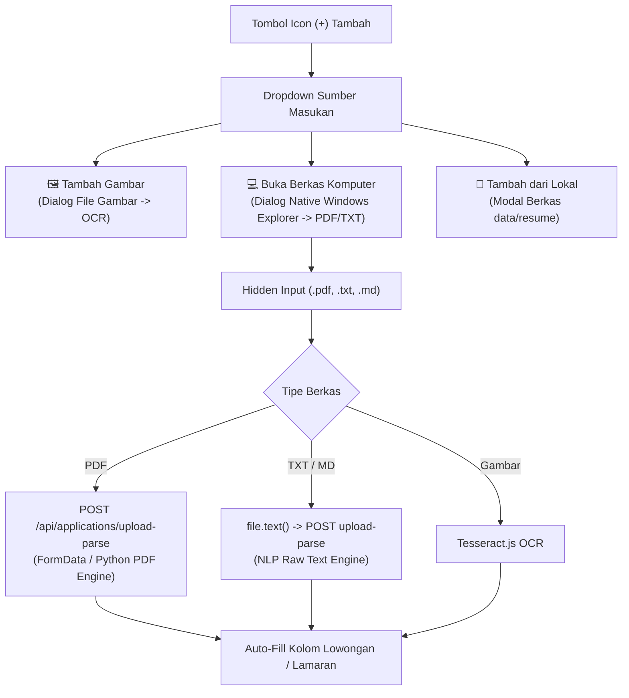

# Changelog: Fitur Dialog Pemilih Berkas Komputer Native (File Explorer) & Resolusi Ref Render React

**Tanggal:** 2026-10-27  
**Waktu:** 19:55 WIB  
**Branch:** `feat/frontend`  
**Nama Commit:** `feat(frontend): add native os document picker option and fix react compiler ref access` (`10-27-2026-19-55-feat-frontend-native-file-picker-and-react-ref-render-fix`)  
**Tipe Perubahan:** `feat` / `fix` (Native OS File Dialog, Document File Upload, React 19 Ref Compiler Resolution, Architecture Compliance)

---

## 1. Ringkasan Perubahan (Executive Summary)

Pembaruan pada branch `feat/frontend` ini menambahkan opsi masukan baru **"Buka Berkas Komputer"** ke dalam menu dropdown tombol `+`, memungkinkan pengguna memilih berkas dokumen langsung melalui dialog native sistem operasi (*Windows File Explorer*), sekaligus memperbaiki peringatan React Compiler terkait akses `ref.current` saat proses render.

### Kebutuhan & Permasalahan:
1. **Keterbatasan Pemilih Berkas Lokal**:
   - Opsi *"Tambah dari Lokal"* sebelumnya hanya menampilkan modal daftar berkas arsip yang sudah tersimpan di direktori `data/resume`. Pengguna membutuhkan cara untuk memilih berkas dari folder mana pun di komputernya (*Downloads*, *Documents*, *Desktop*, dll.) tanpa harus memindahkan berkas terlebih dahulu.
2. **Galat Akses Ref saat Render (*React Compiler / Turbopack Rule*)**:
   - `fileInputRef.current` dan `docInputRef.current` yang ditutup di dalam definisi array saat render di [RawTextParserTab.tsx](file:///c:/Users/MyBook%20Hype%20AMD/OneDrive/Documents/kerja/_code/tracker_job/features/applications/components/ApplicationModal/RawTextParserTab.tsx) memicu galat: `Error: Cannot access refs during render`.

### Solusi yang Diimplementasikan:
1. **Opsi Baru — 💻 Buka Berkas Komputer (*Native OS File Explorer*)**:
   - Ditambahkan pada menu dropdown sumber masukan di [JobInputMediaMenu.tsx](file:///c:/Users/MyBook%20Hype%20AMD/OneDrive/Documents/kerja/_code/tracker_job/features/analyzer/components/JobInputMediaMenu.tsx) dan [RawTextParserTab.tsx](file:///c:/Users/MyBook%20Hype%20AMD/OneDrive/Documents/kerja/_code/tracker_job/features/applications/components/ApplicationModal/RawTextParserTab.tsx).
   - Membuka dialog pemilih berkas native sistem operasi peramban (`<input type="file" accept=".pdf,.txt,.md,.doc,.docx" />`).
2. **Dukungan Multi-Format Dokumen ([use-job-input-ocr.ts](file:///c:/Users/MyBook%20Hype%20AMD/OneDrive/Documents/kerja/_code/tracker_job/features/analyzer/hooks/use-job-input-ocr.ts))**:
   - Ditambahkan fungsi `handleUploadDocument`:
     - **PDF (`.pdf`)**: Diunggah ke endpoint backend `/api/applications/upload-parse` via `multipart/form-data`, diparsing dengan Python, dan diekstrak teks serta entitasnya secara menyeluruh.
     - **Teks / Markdown (`.txt`, `.md`)**: Dibaca langsung menggunakan API `file.text()` di peramban dan diuraikan melalui engine NLP backend.
     - **Gambar (`image/*`)**: Otomatis dialihkan ke pipeline OCR Tesseract.
   - Hasil teks, posisi pekerjaan, dan nama perusahaan otomatis diisikan ke dalam formulir lowongan / lamaran.
3. **Resolusi Galat Ref Render React**:
   - Di [RawTextParserTab.tsx](file:///c:/Users/MyBook%20Hype%20AMD/OneDrive/Documents/kerja/_code/tracker_job/features/applications/components/ApplicationModal/RawTextParserTab.tsx), array opsi menu (`MENU_OPTIONS`) didefinisikan secara statis di luar tubuh komponen.
   - Pemanggilan `ref.current?.click()` diisolasi secara ketat di dalam fungsi penanganan event `handleMenuItemClick(id)`, sehingga aman dan sepenuhnya mematuhi aturan React 19 / React Compiler.

---

## 2. Diagram Alur Pilihan Sumber Masukan



---

## 3. Rincian Modifikasi Berkas

| Berkas | Tipe | Ukuran | Deskripsi |
| :--- | :---: | :---: | :--- |
| [features/analyzer/components/JobInputMediaMenu.tsx](file:///c:/Users/MyBook%20Hype%20AMD/OneDrive/Documents/kerja/_code/tracker_job/features/analyzer/components/JobInputMediaMenu.tsx) | `modified` | **232 baris** | Menambahkan opsi *Buka Berkas Komputer* (ikon `Laptop` aksen emerald), referensi input berkas dokumen native, dan penanganan unggahan. |
| [features/analyzer/hooks/use-job-input-ocr.ts](file:///c:/Users/MyBook%20Hype%20AMD/OneDrive/Documents/kerja/_code/tracker_job/features/analyzer/hooks/use-job-input-ocr.ts) | `modified` | **229 baris** | Menambahkan handler `handleUploadDocument` yang mendukung ekstraksi berkas PDF via backend API dan file teks/markdown via `file.text()`. |
| [features/applications/components/ApplicationModal/RawTextParserTab.tsx](file:///c:/Users/MyBook%20Hype%20AMD/OneDrive/Documents/kerja/_code/tracker_job/features/applications/components/ApplicationModal/RawTextParserTab.tsx) | `modified` | **229 baris** | Menambahkan opsi dokumen native dan memindahkan `MENU_OPTIONS` ke luar komponen dengan pemanggilan ref di event handler untuk menuntaskan galat React Compiler. |

---

## 4. Statistik Perubahan Baris Kode (Git Diff Stats)

```text
 features/analyzer/components/JobInputMediaMenu.tsx | 39 ++++++++-
 features/analyzer/hooks/use-job-input-ocr.ts       | 58 +++++++++++++
 .../ApplicationModal/RawTextParserTab.tsx          | 95 +++++++++++-----------
 3 files changed, 143 insertions(+), 49 deletions(-)
```

---

## 5. Hasil Pengujian & Jaminan Mutu (Verification & QA)

1. **Kepatuhan Batas Baris Kode (*Bulk Lines Policy*)**:
   - Seluruh 3 berkas yang dimodifikasi diverifikasi memiliki ukuran **< 235 baris** (mematuhi batas maksimal 250 baris per berkas):
     - `JobInputMediaMenu.tsx`: 232 baris
     - `use-job-input-ocr.ts`: 229 baris
     - `RawTextParserTab.tsx`: 229 baris
2. **Pemeriksaan Tipe TypeScript (`npx tsc --noEmit`)**:
   - Lulus 100% tanpa kesalahan tipe (*0 errors, exit code: 0*).
3. **Resolusi Galat Render React**:
   - Galat *"Cannot access refs during render"* tuntas 100% dan halaman `/analyzer` serta modal aplikasi dapat dibuka dan dijalankan tanpa peringatan.
