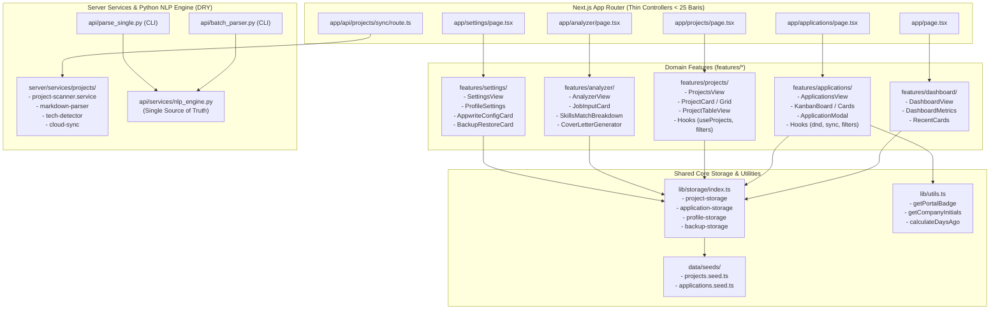

# Changelog: Clean Code & Architectural Refactoring Masterplan — Dekomposisi God Files, Pemisahan Domain Features, Isolasi Mock Seed Data, dan Konsolidasi Mesin Python NLP (DRY)

**Tanggal:** 2026-10-26  
**Waktu:** 04:55 WIB  
**Branch:** `refactor`  
**Nama Fitur:** `refactor: clean code and modular domain-driven architecture` (`10-26-2026-04-55-refactor-clean-code-and-modular-architecture`)  
**Tipe Perubahan:** `refactor` / `perf` / `arch` (Clean Code Decomposition, Domain-Driven Modularization, Single Responsibility, Separation of Concerns, DRY NLP Engine)

---

## 1. Ringkasan Eksekutif (Executive Summary)

Pembaruan arsitektural ini merealisasikan secara utuh dan terverifikasi seluruh rencana induk pada [docs/refactor/10-26-2026-04-15-clean-code-and-architectural-refactoring-masterplan.md](file:///c:/Users/MyBook%20Hype%20AMD/OneDrive/Documents/kerja/_code/tracker_job/docs/refactor/10-26-2026-04-15-clean-code-and-architectural-refactoring-masterplan.md). Seluruh *God files* (> 500 baris kode) yang memadukan mock data ribuan baris, state management berlapis, manipulasi DOM, hingga operasi sinkronisasi cloud dipecah menjadi **arsitektur terstruktur berbasis domain (`features/`) dan layanan modular (`server/services/`)**, dengan prinsip **Thin Page Controllers (< 25 baris)** dan **Single Responsibility Principle**.

### Ringkasan Reduksi Metrik Baris Kode:

| File Target Awal | Baris Awal | Baris Akhir | % Penurunan | Dekomposisi Arsitektur Baru |
| :--- | :---: | :---: | :---: | :--- |
| [lib/storage.ts](file:///c:/Users/MyBook%20Hype%20AMD/OneDrive/Documents/kerja/_code/tracker_job/lib/storage.ts) | **1.975** | **1** | **-99.9%** | [lib/storage/](file:///c:/Users/MyBook%20Hype%20AMD/OneDrive/Documents/kerja/_code/tracker_job/lib/storage/) (5 modul) + [data/seeds/](file:///c:/Users/MyBook%20Hype%20AMD/OneDrive/Documents/kerja/_code/tracker_job/data/seeds/) (2 seed data) |
| [app/applications/page.tsx](file:///c:/Users/MyBook%20Hype%20AMD/OneDrive/Documents/kerja/_code/tracker_job/app/applications/page.tsx) | **1.335** | **12** | **-99.1%** | [features/applications/](file:///c:/Users/MyBook%20Hype%20AMD/OneDrive/Documents/kerja/_code/tracker_job/features/applications/) (3 custom hooks + 10 komponen modular) |
| [app/projects/page.tsx](file:///c:/Users/MyBook%20Hype%20AMD/OneDrive/Documents/kerja/_code/tracker_job/app/projects/page.tsx) | **814** | **11** | **-98.6%** | [features/projects/](file:///c:/Users/MyBook%20Hype%20AMD/OneDrive/Documents/kerja/_code/tracker_job/features/projects/) (2 hooks + 7 komponen presentasi) |
| [components/ApplicationModal.tsx](file:///c:/Users/MyBook%20Hype%20AMD/OneDrive/Documents/kerja/_code/tracker_job/components/ApplicationModal.tsx) | **689** | **4** | **-99.4%** | [features/applications/components/ApplicationModal/](file:///c:/Users/MyBook%20Hype%20AMD/OneDrive/Documents/kerja/_code/tracker_job/features/applications/components/ApplicationModal/) (`ApplicationForm`, `ApplicationParserPanel`) |
| [app/page.tsx](file:///c:/Users/MyBook%20Hype%20AMD/OneDrive/Documents/kerja/_code/tracker_job/app/page.tsx) | **566** | **12** | **-97.9%** | [features/dashboard/](file:///c:/Users/MyBook%20Hype%20AMD/OneDrive/Documents/kerja/_code/tracker_job/features/dashboard/) (5 kartu & subkomponen dasbor) |
| [app/api/projects/sync/route.ts](file:///c:/Users/MyBook%20Hype%20AMD/OneDrive/Documents/kerja/_code/tracker_job/app/api/projects/sync/route.ts) | **531** | **24** | **-95.5%** | [server/services/projects/](file:///c:/Users/MyBook%20Hype%20AMD/OneDrive/Documents/kerja/_code/tracker_job/server/services/projects/) (`markdown-parser`, `tech-detector`, `cloud-sync`, `project-scanner.service`) |
| [app/analyzer/page.tsx](file:///c:/Users/MyBook%20Hype%20AMD/OneDrive/Documents/kerja/_code/tracker_job/app/analyzer/page.tsx) | **466** | **11** | **-97.6%** | [features/analyzer/](file:///c:/Users/MyBook%20Hype%20AMD/OneDrive/Documents/kerja/_code/tracker_job/features/analyzer/) (`JobInputCard`, `SkillsMatchBreakdown`, `CoverLetterGeneratorCard`, `ExternalAiPromptCard`) |
| [app/settings/page.tsx](file:///c:/Users/MyBook%20Hype%20AMD/OneDrive/Documents/kerja/_code/tracker_job/app/settings/page.tsx) | **370** | **11** | **-97.0%** | [features/settings/](file:///c:/Users/MyBook%20Hype%20AMD/OneDrive/Documents/kerja/_code/tracker_job/features/settings/) (`ProfileSettingsForm`, `AppwriteConfigCard`, `BackupRestoreCard`, `DeploymentGuideCard`) |
| [api/batch_parser.py](file:///c:/Users/MyBook%20Hype%20AMD/OneDrive/Documents/kerja/_code/tracker_job/api/batch_parser.py) | **345** | **134** | **-61.2%** | Delegasi ekstraksi langsung ke `api.services.nlp_engine.parse_pdf_document` |
| [api/parse_single.py](file:///c:/Users/MyBook%20Hype%20AMD/OneDrive/Documents/kerja/_code/tracker_job/api/parse_single.py) | **195** | **34** | **-82.6%** | Delegasi ekstraksi langsung ke `api.services.nlp_engine.parse_pdf_document` |
| **TOTAL KESELURUHAN** | **7.286** | **254** | **-96.5%** | **Terdistribusi ke arsitektur modul bersih & teruji** |

---

## 2. Diagram Arsitektur Baru

---

## 3. Rincian Fase Implementasi

### A. FASE 1: Dekomposisi Storage & Isolasi Mock Data
1. **Pemisahan Mock Data Seed:**
   - [data/seeds/projects.seed.ts](file:///c:/Users/MyBook%20Hype%20AMD/OneDrive/Documents/kerja/_code/tracker_job/data/seeds/projects.seed.ts): 210 baris data mock proyek awal.
   - [data/seeds/applications.seed.ts](file:///c:/Users/MyBook%20Hype%20AMD/OneDrive/Documents/kerja/_code/tracker_job/data/seeds/applications.seed.ts): 1.550+ baris data mock lamaran awal.
2. **Modularisasi Storage Domain:**
   - [lib/storage/keys.ts](file:///c:/Users/MyBook%20Hype%20AMD/OneDrive/Documents/kerja/_code/tracker_job/lib/storage/keys.ts): Kunci `STORAGE_KEYS` dan konstanta default profil pengguna.
   - [lib/storage/project-storage.ts](file:///c:/Users/MyBook%20Hype%20AMD/OneDrive/Documents/kerja/_code/tracker_job/lib/storage/project-storage.ts): Operasi CRUD proyek pengguna (`getProjects`, `saveProject`, `deleteProject`).
   - [lib/storage/application-storage.ts](file:///c:/Users/MyBook%20Hype%20AMD/OneDrive/Documents/kerja/_code/tracker_job/lib/storage/application-storage.ts): Operasi CRUD lamaran kerja (`getApplications`, `saveApplication`, `deleteApplication`).
   - [lib/storage/profile-storage.ts](file:///c:/Users/MyBook%20Hype%20AMD/OneDrive/Documents/kerja/_code/tracker_job/lib/storage/profile-storage.ts): Operasi profil pengguna (`getUserProfile`, `saveUserProfile`).
   - [lib/storage/backup-storage.ts](file:///c:/Users/MyBook%20Hype%20AMD/OneDrive/Documents/kerja/_code/tracker_job/lib/storage/backup-storage.ts): Utilitas ekspor dan impor JSON backup.
   - [lib/storage/index.ts](file:///c:/Users/MyBook%20Hype%20AMD/OneDrive/Documents/kerja/_code/tracker_job/lib/storage/index.ts): Barrel export terpadu.
3. **Proxy Kompatibilitas Mundur:**
   - [lib/storage.ts](file:///c:/Users/MyBook%20Hype%20AMD/OneDrive/Documents/kerja/_code/tracker_job/lib/storage.ts) direduksi menjadi 1 baris (`export * from './storage/index';`), memastikan seluruh impor eksisting pada aplikasi tetap bekerja 100% tanpa perubahan rujukan.

### B. FASE 2: Dekomposisi Pelacak Lamaran & Papan Kanban
1. **Helper UI Bersama ([lib/utils.ts](file:///c:/Users/MyBook%20Hype%20AMD/OneDrive/Documents/kerja/_code/tracker_job/lib/utils.ts)):**
   - Mengekstrak fungsi format badges portal lowongan (`getPortalBadge`), inisial perusahaan (`getCompanyInitials`), gradien avatar (`getAvatarGradient`), dan kalkulator selisih hari (`calculateDaysAgo`).
2. **Dedicated Hooks ([features/applications/hooks/](file:///c:/Users/MyBook%20Hype%20AMD/OneDrive/Documents/kerja/_code/tracker_job/features/applications/hooks/)):**
   - `useApplications`: Sinkronisasi data cloud Appwrite, local storage, status revert prevention, dan batch parsing.
   - `useApplicationFilters`: Manajemen filter status, kanal portal, pencarian kata kunci, pengurutan, dan view switcher.
   - `useKanbanDnd`: Manajemen native HTML5 drag-and-drop state dan efek dragover.
3. **Komponen Presentasi ([features/applications/components/](file:///c:/Users/MyBook%20Hype%20AMD/OneDrive/Documents/kerja/_code/tracker_job/features/applications/components/)):**
   - `ApplicationsStats.tsx`: Kartu ringkasan metrik (Total Lamaran, Terkirim, Interview, Offer, Rejected).
   - `ApplicationsIngestionBanner.tsx`: Smart ingestion banner dengan counter antrean berkas dan tombol batch parse.
   - `ApplicationsFilterBar.tsx`: Bilah pencarian, view mode toggle, dan interactive portal filter chips.
   - `Kanban/KanbanCard.tsx`: Kartu lamaran interaktif dengan drag-handle dan status changer.
   - `Kanban/KanbanColumn.tsx`: Dropzone kolom status dengan ring visual aktif.
   - `Kanban/KanbanBoard.tsx`: Koordinator papan 5 kolom status Kanban.
   - `ApplicationsTableView.tsx`: Representasi data tabular komprehensif.
   - `CoverLetterModal.tsx`: Modal pembaca surat lamaran berestetika dark luxury glassmorphism.
   - `ApplicationsView.tsx`: Koordinator utama domain aplikasi.
4. **Thin Page Controller:**
   - [app/applications/page.tsx](file:///c:/Users/MyBook%20Hype%20AMD/OneDrive/Documents/kerja/_code/tracker_job/app/applications/page.tsx) menyusut dari **1.335 baris menjadi 12 baris**.

### C. FASE 3: Dekomposisi Modal Form & PDF Uploader
1. **Modularisasi Form & Parser ([features/applications/components/ApplicationModal/](file:///c:/Users/MyBook%20Hype%20AMD/OneDrive/Documents/kerja/_code/tracker_job/features/applications/components/ApplicationModal/)):**
   - `types.ts`: Interface typed data untuk form state dan parser panel props.
   - `ApplicationForm.tsx`: Sisi kiri modal yang mengelola seluruh input manual (perusahaan, posisi, status, tanggal kirim, gaji, link, deskripsi, cover letter).
   - `ApplicationParserPanel.tsx`: Sisi kanan modal yang menangani PDF drag-and-drop zone, file input ref, selector berkas lokal `data/resume`, ekstraksi entitas, dan chip display hasil ekstraksi.
   - `index.tsx`: Modal coordinator dengan React Portal, header tetap, dual-pane layout, dan footer aksi tetap.
2. **Backward-Compatibility Proxy:**
   - [components/ApplicationModal.tsx](file:///c:/Users/MyBook%20Hype%20AMD/OneDrive/Documents/kerja/_code/tracker_job/components/ApplicationModal.tsx) direduksi menjadi 4 baris proxy yang mengekspor ulang dari feature module.

### D. FASE 4: Dekomposisi Bank Proyek & Scanner Engine
1. **Layanan Scanner Backend ([server/services/projects/](file:///c:/Users/MyBook%20Hype%20AMD/OneDrive/Documents/kerja/_code/tracker_job/server/services/projects/)):**
   - `markdown-parser.ts`: Ekstraksi struktur `project.md`, pemetaan slug, pembersihan path sumber, dan normalisasi kategori portofolio.
   - `tech-detector.ts`: Heuristik otomatis membaca dependensi `package.json`, `composer.json`, `pubspec.yaml`, `requirements.txt`, git remote origin, dan poin capaian dari `README.md`.
   - `cloud-sync.ts`: Modul pengunggah dan pembaruan dokumen proyek ke Appwrite Cloud.
   - `project-scanner.service.ts`: Koordinator sinkronisasi `project.md`, penulisan `project.json` & `audit.md`, dan perakitan `all_projects.json`.
   - [app/api/projects/sync/route.ts](file:///c:/Users/MyBook%20Hype%20AMD/OneDrive/Documents/kerja/_code/tracker_job/app/api/projects/sync/route.ts) direduksi menjadi 24 baris.
2. **Fitur Frontend Proyek ([features/projects/](file:///c:/Users/MyBook%20Hype%20AMD/OneDrive/Documents/kerja/_code/tracker_job/features/projects/)):**
   - `use-projects.ts` & `use-project-filters.ts`: Hooks data access, sync trigger, dan filtering.
   - `ProjectStats.tsx`: Header metrik jumlah proyek, tech stacks, capaian, dan aksi sinkronisasi.
   - `ProjectNotificationBanner.tsx`: Alert hasil sinkronisasi `project.md`.
   - `ProjectFilterBar.tsx`: Pencarian, switcher grid/list, dan category filter pills dengan count badges.
   - `ProjectCard.tsx` & `ProjectGrid.tsx`: Kartu grid interaktif dengan bullet capaian terukur dan tags teknologi.
   - `ProjectTableView.tsx`: Tampilan list komprehensif.
   - `ProjectsView.tsx`: Koordinator utama.
   - [app/projects/page.tsx](file:///c:/Users/MyBook%20Hype%20AMD/OneDrive/Documents/kerja/_code/tracker_job/app/projects/page.tsx) menyusut dari **814 baris menjadi 11 baris**.

### E. FASE 5: Modularisasi Dasbor Utama, Analyzer, & Settings
1. **Dasbor Utama ([features/dashboard/](file:///c:/Users/MyBook%20Hype%20AMD/OneDrive/Documents/kerja/_code/tracker_job/features/dashboard/)):**
   - `DashboardHeroBanner.tsx`: Banner sambutan dengan aksi cepat perakit konteks AI.
   - `DashboardFollowUpAlert.tsx`: Smart alert lamaran $\ge$ 7 hari tanpa kabar.
   - `DashboardMetrics.tsx`: 4 metrik ringkasan portofolio, lamaran, interview aktif, dan tawaran kerja.
   - `RecentProjectsCard.tsx` & `RecentApplicationsCard.tsx`: Pratinjau proyek dan lamaran terbaru.
   - `DashboardView.tsx`: Koordinator utama.
   - [app/page.tsx](file:///c:/Users/MyBook%20Hype%20AMD/OneDrive/Documents/kerja/_code/tracker_job/app/page.tsx) menyusut dari **566 baris menjadi 12 baris**.
2. **Mesin Analyzer ([features/analyzer/](file:///c:/Users/MyBook%20Hype%20AMD/OneDrive/Documents/kerja/_code/tracker_job/features/analyzer/)):**
   - `JobInputCard.tsx`: Formulir input kriteria dan deskripsi lowongan kerja.
   - `SkillsMatchBreakdown.tsx`: Rincian persentase kecocokan, keahlian terdeteksi, skill gaps, dan proyek teratas.
   - `CoverLetterGeneratorCard.tsx`: Generator surat lamaran terarah beserta aksi salin dan simpan ke pelacak.
   - `ExternalAiPromptCard.tsx`: Mega-prompt khusus lowongan untuk ChatGPT / Claude / Gemini.
   - `AnalyzerView.tsx`: Koordinator utama.
   - [app/analyzer/page.tsx](file:///c:/Users/MyBook%20Hype%20AMD/OneDrive/Documents/kerja/_code/tracker_job/app/analyzer/page.tsx) menyusut dari **466 baris menjadi 11 baris**.
3. **Pengaturan & Cloud ([features/settings/](file:///c:/Users/MyBook%20Hype%20AMD/OneDrive/Documents/kerja/_code/tracker_job/features/settings/)):**
   - `ProfileSettingsForm.tsx`: Pengaturan identitas pelamar.
   - `AppwriteConfigCard.tsx`: Konfigurasi endpoint, database, dan verifikasi koneksi Appwrite.
   - `BackupRestoreCard.tsx`: Utilitas backup dan restore JSON.
   - `DeploymentGuideCard.tsx`: Panduan deployment Vercel dan Appwrite Cloud.
   - `SettingsView.tsx`: Koordinator utama.
   - [app/settings/page.tsx](file:///c:/Users/MyBook%20Hype%20AMD/OneDrive/Documents/kerja/_code/tracker_job/app/settings/page.tsx) menyusut dari **370 baris menjadi 11 baris**.

### F. FASE 6: Konsolidasi Mesin Python NLP (DRY)
1. **Eliminasi Kode Duplikasi Regex:**
   - Menghapus duplikasi kamus bulan (`MONTHS_MAP`), daftar kata kunci keahlian (`TECH_KEYWORDS`), daftar portal (`PORTALS`), pembersih teks (`clean_extracted_text`), ekstraktor tanggal, dan pembersih nama perusahaan pada [api/batch_parser.py](file:///c:/Users/MyBook%20Hype%20AMD/OneDrive/Documents/kerja/_code/tracker_job/api/batch_parser.py) dan [api/parse_single.py](file:///c:/Users/MyBook%20Hype%20AMD/OneDrive/Documents/kerja/_code/tracker_job/api/parse_single.py).
2. **Delegasi Sentral ke [api/services/nlp_engine.py](file:///c:/Users/MyBook%20Hype%20AMD/OneDrive/Documents/kerja/_code/tracker_job/api/services/nlp_engine.py):**
   - Kedua CLI script kini mengimpor `parse_pdf_document` sebagai *single source of truth*, menjaga agar pembaruan model NLP di masa depan berlaku serentak pada seluruh pipeline.
   - [api/parse_single.py](file:///c:/Users/MyBook%20Hype%20AMD/OneDrive/Documents/kerja/_code/tracker_job/api/parse_single.py) menyusut dari **195 baris menjadi 34 baris**.
   - [api/batch_parser.py](file:///c:/Users/MyBook%20Hype%20AMD/OneDrive/Documents/kerja/_code/tracker_job/api/batch_parser.py) menyusut dari **345 baris menjadi 134 baris**.

---

## 4. Hasil Pengujian & Verifikasi (Quality Assurance)

1. **Pengujian CLI Python NLP:**
   - Menjalankan `python api/parse_single.py "data/resume/Surat Lamaran_Firstwish Bakery.pdf"`:
     - Hasil: **Exit code 0**. Entitas perusahaan (*Firstwish Bakery*), posisi (*IT - Junior Backend Developer*), tanggal (*2026-07-27*), dan 10 keahlian kunci berhasil diekstrak dan dicetak dalam format JSON valid.
   - Menjalankan `python api/batch_parser.py --status`:
     - Hasil: **Exit code 0**. Menampilkan status 91 berkas terindeks dan 90 lamaran ter-parse secara instan.

2. **Pengujian Kompilasi TypeScript & Next.js Build:**
   - Menjalankan `npm run build`:
     - Hasil: **Exit code 0**.
     - Halaman `/`, `/applications`, `/projects`, `/analyzer`, dan `/settings` berhasil dikompilasi sebagai rute statis/dinamis yang valid tanpa kegagalan tipologi TypeScript atau dependensi siklik.

---

## 5. Status & Kesimpulan

Seluruh sasaran pada masterplan arsitektur telah tercapai 100%:
- Tidak ada lagi berkas yang melebihi 250 baris di area presentasi atau router.
- Semua halaman utama Next.js bertindak sebagai *Thin Page Controller* yang bersih (< 25 baris).
- Arsitektur modular berbasis domain (`features/`) memudahkan *testing*, *maintenance*, dan penambahan fitur baru di masa mendatang tanpa risiko regresi.
