# Changelog: Eliminasi Menyeluruh Bulk Lines & Konsolidasi Arsitektur Bersih (Clean Architecture)

**Tanggal:** 2026-10-27  
**Waktu:** 09:50 WIB  
**Branch:** `refactor`  
**Nama Commit / Fitur:** `refactor(core): eliminate bulk lines, decouple god components and consolidate domain architecture` (`10-27-2026-09-50-refactor-bulk-lines-and-clean-architecture-consolidation`)  
**Tipe Perubahan:** `refactor` / `perf` / `arch` (Bulk Lines Elimination, Feature-Driven Architecture Consolidation, Single Responsibility Decomposition, Zero Breaking Changes)

---

## 1. Ringkasan Eksekutif (Executive Summary)

Pembaruan arsitektur pada branch `refactor` ini menuntaskan secara menyeluruh seluruh 10 temuan berkas dengan baris kode berlebih (*bulk lines* > 250 baris) dan pelanggaran struktur arsitektur yang teridentifikasi dalam audit menyeluruh pasca-merge branch `main`.

### Konteks & Permasalahan Sebelum Refactoring:
1. **`components/TechStackModal.tsx` (517 baris)**: Bertindak sebagai *God Modal* yang memadukan kalkulasi aggregasi Map teknologi, filter pencarian teks, tab kategori ekosistem, rendering grid mode global, akordeon proyek terhubung, dan rendering mode per-proyek dalam satu berkas tunggal.
2. **`api/services/analyzer.py` (507 baris)**: Akibat merge dari `main`, berkas ini membengkak karena memuat 230+ baris string template surat lamaran bahasa Inggris dan Indonesia (4 variasi tone: profesional, antusias, ringkas, teknikal) bercampur baur dengan algoritma pencocokan multi-faktor dan ekstraksi kata kunci NLP.
3. **`components/tech-stack/TechIcon.tsx` (447 baris)**: Menggabungkan fungsi penentuan taksonomi domain dan kamus 60+ render SVG logo brand ke dalam satu berkas.
4. **`features/analyzer/components/AnalyzerView.tsx` (337 baris)**: Komponen UI memuat seluruh *state management*, pemanggilan API Python `/api/py/analyze-job`, regenerasi surat lamaran, auto-save ke Appwrite/Storage, dan salin clipboard tanpa pemisahan custom hook.
5. **`lib/appwrite.ts` (299 baris)**: Modul infrastruktur monolitik yang menggabungkan konfigurasi client SDK, validasi regex UID dokumen, repository CRUD Proyek, dan repository CRUD Lamaran.
6. **`features/analyzer/components/SkillsMatchBreakdown.tsx` (296 baris)**: Komponen inisialisasi circular SVG gauge wheel, tema dinamis, breakdown taksonomi skill, dan kartu skill gap dalam satu berkas.
7. **`components/ProjectModal.tsx` (295 baris) & `components/ProjectDetailModal.tsx` (261 baris)**: Komponen modal spesifik domain proyek yang salah penempatan di root `components/`, bukan di `features/projects/components/`.
8. **`features/applications/components/ApplicationModal/index.tsx` (268 baris)**: Kontainer modal yang menangani state parsing dan file upload PDF lokal tanpa custom hook terpisah.
9. **`features/applications/hooks/use-applications.ts` (252 baris)**: Hook state lamaran yang memuat logika parsing batch duplikatif dan orkestrasi notifikasi sinkronisasi.

### Hasil Setelah Refactoring:
- **100% berkas kode produksi kini berukuran di bawah 250 baris** (berkas tertinggi dalam basis kode adalah `ApplicationParserPanel.tsx` dengan 245 baris).
- **Semua komponen dan modal spesifik fitur telah direlokasi ke foldernya masing-masing** (`features/projects/`, `features/analyzer/`, `features/applications/`, `lib/appwrite/`).
- **Jaminan Kompatibilitas Penuh (Zero Breaking Changes)**: Menyediakan *re-export shims* di `components/ProjectModal.tsx`, `components/ProjectDetailModal.tsx`, dan `lib/appwrite.ts` sehingga impor lama dari seluruh aplikasi tetap berfungsi tanpa perlu refactor pemanggil.
- **TypeScript Type Checking (`npx tsc --noEmit`) & Next.js Production Build (`npm run build`)**: Lulus 100% tanpa error (*Exit Code: 0*).
- **Python Backend Compilation (`python -m py_compile`)**: Lulus 100% tanpa error (*Exit Code: 0*).

---

## 2. Metrik Perbandingan Baris Kode (Sebelum vs Sesudah)

| Berkas Sasaran | Sebelum | Sesudah | Berkas Hasil Dekomposisi Baru | Pengurangan | Status |
| :--- | :---: | :---: | :--- | :---: | :---: |
| [components/TechStackModal.tsx](file:///c:/Users/MyBook%20Hype%20AMD/OneDrive/Documents/kerja/_code/tracker_job/components/TechStackModal.tsx) | **517** | **187** | `use-tech-aggregation.ts` (105), `TechEcosystemGrid.tsx` (132), `TechCategoryTabs.tsx` (95), `ProjectTechBreakdown.tsx` (85) | **-64%** | Tereliminasi |
| [api/services/analyzer.py](file:///c:/Users/MyBook%20Hype%20AMD/OneDrive/Documents/kerja/_code/tracker_job/api/services/analyzer.py) | **507** | **127** | `cover_letter_generator.py` (217), `match_engine.py` (188) | **-75%** | Tereliminasi |
| [components/tech-stack/TechIcon.tsx](file:///c:/Users/MyBook%20Hype%20AMD/OneDrive/Documents/kerja/_code/tracker_job/components/tech-stack/TechIcon.tsx) | **447** | **55** | `tech-taxonomy.ts` (187), `brand-svgs.tsx` (245) | **-88%** | Tereliminasi |
| [features/analyzer/components/AnalyzerView.tsx](file:///c:/Users/MyBook%20Hype%20AMD/OneDrive/Documents/kerja/_code/tracker_job/features/analyzer/components/AnalyzerView.tsx) | **337** | **182** | `hooks/use-job-analyzer.ts` (183) | **-46%** | Tereliminasi |
| [lib/appwrite.ts](file:///c:/Users/MyBook%20Hype%20AMD/OneDrive/Documents/kerja/_code/tracker_job/lib/appwrite.ts) | **299** | **1** | `client.ts` (58), `validation.ts` (14), `projects.ts` (88), `applications.ts` (120) | **-99%** | Tereliminasi |
| [features/analyzer/components/SkillsMatchBreakdown.tsx](file:///c:/Users/MyBook%20Hype%20AMD/OneDrive/Documents/kerja/_code/tracker_job/features/analyzer/components/SkillsMatchBreakdown.tsx) | **296** | **230** | `MatchScoreGauge.tsx` (66) | **-22%** | Tereliminasi |
| [components/ProjectModal.tsx](file:///c:/Users/MyBook%20Hype%20AMD/OneDrive/Documents/kerja/_code/tracker_job/components/ProjectModal.tsx) | **295** | **2** | `features/projects/components/ProjectModal.tsx` (150), `ProjectFormFields.tsx` (202) | **-99%** | Tereliminasi |
| [features/applications/components/ApplicationModal/index.tsx](file:///c:/Users/MyBook%20Hype%20AMD/OneDrive/Documents/kerja/_code/tracker_job/features/applications/components/ApplicationModal/index.tsx) | **268** | **171** | `use-resume-parser.ts` (132) | **-36%** | Tereliminasi |
| [components/ProjectDetailModal.tsx](file:///c:/Users/MyBook%20Hype%20AMD/OneDrive/Documents/kerja/_code/tracker_job/components/ProjectDetailModal.tsx) | **261** | **2** | `features/projects/components/ProjectDetailModal.tsx` (140), `ProjectDetailBody.tsx` (173) | **-99%** | Tereliminasi |
| [features/applications/hooks/use-applications.ts](file:///c:/Users/MyBook%20Hype%20AMD/OneDrive/Documents/kerja/_code/tracker_job/features/applications/hooks/use-applications.ts) | **252** | **160** | `use-applications-sync.ts` (118) | **-37%** | Tereliminasi |
| **TOTAL BARIS KODE AUDIT** | **3.479** | **1.117** | **21 modul modular baru (< 250 baris)** | **-67.9%** | **Bersih 100%** |

---

## 3. Diagram Arsitektur Dekomposisi Bersih (Clean Architecture)

```mermaid
graph TD
    subgraph "Presentation Layer (Pure UI Components < 200 Baris)"
        TSM["components/TechStackModal.tsx (187 l)"]
        AV["features/analyzer/AnalyzerView.tsx (182 l)"]
        SMB["features/analyzer/SkillsMatchBreakdown.tsx (230 l)"]
        PM["features/projects/ProjectModal.tsx (150 l)"]
        PDM["features/projects/ProjectDetailModal.tsx (140 l)"]
        AM["features/applications/ApplicationModal/index.tsx (171 l)"]
    end

    subgraph "Sub-Components & Pure Visuals"
        TEG["TechEcosystemGrid.tsx (132 l)"]
        TCT["TechCategoryTabs.tsx (95 l)"]
        PTB["ProjectTechBreakdown.tsx (85 l)"]
        MSG["MatchScoreGauge.tsx (66 l)"]
        PFF["ProjectFormFields.tsx (202 l)"]
        PDB["ProjectDetailBody.tsx (173 l)"]
        TI["TechIcon.tsx (55 l)"]
        SVG["brand-svgs.tsx (245 l)"]
        TAX["tech-taxonomy.ts (187 l)"]
    end

    subgraph "Domain Custom Hooks (Logic & State)"
        UTA["use-tech-aggregation.ts (105 l)"]
        UJA["use-job-analyzer.ts (183 l)"]
        URP["use-resume-parser.ts (132 l)"]
        UAS["use-applications-sync.ts (118 l)"]
        UA["use-applications.ts (160 l)"]
    end

    subgraph "Modular Infrastructure (lib/appwrite/)"
        AC["client.ts (58 l)"]
        AVAL["validation.ts (14 l)"]
        APROJ["projects.ts (88 l)"]
        AAPP["applications.ts (120 l)"]
        ABAR["index.ts & lib/appwrite.ts (1 l shim)"]
    end

    subgraph "Python NLP & Job Match Engine (api/services/)"
        AZ["analyzer.py (Pipeline Orchestrator - 127 l)"]
        CLG["cover_letter_generator.py (217 l)"]
        ME["match_engine.py (188 l)"]
    end

    TSM --> UTA
    TSM --> TEG
    TSM --> TCT
    TSM --> PTB
    TEG --> TI
    TI --> SVG
    TI --> TAX

    AV --> UJA
    SMB --> MSG

    PM --> PFF
    PDM --> PDB

    AM --> URP
    UA --> UAS

    APROJ --> AC
    APROJ --> AVAL
    AAPP --> AC
    AAPP --> AVAL
    ABAR --> APROJ
    ABAR --> AAPP

    AZ --> CLG
    AZ --> ME
```

---

## 4. Rincian Modifikasi per Domain Fitur

### A. Python Backend Domain (`api/services/`)
- **[api/services/cover_letter_generator.py](file:///c:/Users/MyBook%20Hype%20AMD/OneDrive/Documents/kerja/_code/tracker_job/api/services/cover_letter_generator.py)** *(Baru)*: Mengisolasi fungsi generator surat lamaran multi-tone (*profesional, antusias, ringkas, teknikal*) dan multi-bahasa (Indonesia & Inggris).
- **[api/services/match_engine.py](file:///c:/Users/MyBook%20Hype%20AMD/OneDrive/Documents/kerja/_code/tracker_job/api/services/match_engine.py)** *(Baru)*: Mengisolasi ekstraksi kata kunci NLP berbasis taksonomi, algoritma pencocokan multi-faktor portofolio (*technical stack, role relevance, quantitative metrics, domain context*), serta perumusan *talking points interview*.
- **[api/services/analyzer.py](file:///c:/Users/MyBook%20Hype%20AMD/OneDrive/Documents/kerja/_code/tracker_job/api/services/analyzer.py)**: Disederhanakan menjadi orkestrator pipeline murni (127 baris) dengan re-export transparan untuk menjaga kompatibilitas ke router FastAPI `/api/py/analyze-job`.

### B. Analyzer Feature Domain (`features/analyzer/`)
- **[features/analyzer/hooks/use-job-analyzer.ts](file:///c:/Users/MyBook%20Hype%20AMD/OneDrive/Documents/kerja/_code/tracker_job/features/analyzer/hooks/use-job-analyzer.ts)** *(Baru)*: Memusatkan seluruh state formulir lowongan, integrasi API Python, regenerasi tone cover letter, auto-save ke Appwrite Cloud & LocalStorage, serta interaksi clipboard.
- **[features/analyzer/components/MatchScoreGauge.tsx](file:///c:/Users/MyBook%20Hype%20AMD/OneDrive/Documents/kerja/_code/tracker_job/features/analyzer/components/MatchScoreGauge.tsx)** *(Baru)*: Komponen visual mandiri untuk kalkulasi tema warna dan animasi SVG circular score meter gauge.
- **[features/analyzer/components/AnalyzerView.tsx](file:///c:/Users/MyBook%20Hype%20AMD/OneDrive/Documents/kerja/_code/tracker_job/features/analyzer/components/AnalyzerView.tsx)**: Disederhanakan menjadi *Pure Presentation Component* yang ramping (182 baris).

### C. Projects Feature Domain (`features/projects/`)
- **[features/projects/components/ProjectModal.tsx](file:///c:/Users/MyBook%20Hype%20AMD/OneDrive/Documents/kerja/_code/tracker_job/features/projects/components/ProjectModal.tsx)** *(Relokasi & Baru)*: Modal formulir proyek ditempatkan di dalam domain fitur proyek dengan sub-komponen [ProjectFormFields.tsx](file:///c:/Users/MyBook%20Hype%20AMD/OneDrive/Documents/kerja/_code/tracker_job/features/projects/components/ProjectModal/ProjectFormFields.tsx).
- **[features/projects/components/ProjectDetailModal.tsx](file:///c:/Users/MyBook%20Hype%20AMD/OneDrive/Documents/kerja/_code/tracker_job/features/projects/components/ProjectDetailModal.tsx)** *(Relokasi & Baru)*: Modal detail pembaca dokumen proyek ditempatkan di domain fitur proyek dengan sub-komponen [ProjectDetailBody.tsx](file:///c:/Users/MyBook%20Hype%20AMD/OneDrive/Documents/kerja/_code/tracker_job/features/projects/components/ProjectDetailModal/ProjectDetailBody.tsx).
- **[components/ProjectModal.tsx](file:///c:/Users/MyBook%20Hype%20AMD/OneDrive/Documents/kerja/_code/tracker_job/components/ProjectModal.tsx) & [components/ProjectDetailModal.tsx](file:///c:/Users/MyBook%20Hype%20AMD/OneDrive/Documents/kerja/_code/tracker_job/components/ProjectDetailModal.tsx)**: Diubah menjadi *re-export shim* 2-baris untuk menjamin kompatibilitas impor lama di modul lain.

### D. Tech Stack & Icon Domain (`components/tech-stack/`)
- **[components/tech-stack/tech-taxonomy.ts](file:///c:/Users/MyBook%20Hype%20AMD/OneDrive/Documents/kerja/_code/tracker_job/components/tech-stack/tech-taxonomy.ts)** *(Baru)*: Mengisolasi tipe `TechCategory`, `TechMeta`, dan fungsi pencocokan `getTechMeta()`.
- **[components/tech-stack/brand-svgs.tsx](file:///c:/Users/MyBook%20Hype%20AMD/OneDrive/Documents/kerja/_code/tracker_job/components/tech-stack/brand-svgs.tsx)** *(Baru)*: Mengisolasi 16+ definisi SVG logo brand dan fallback taksonomi Lucide.
- **[components/tech-stack/use-tech-aggregation.ts](file:///c:/Users/MyBook%20Hype%20AMD/OneDrive/Documents/kerja/_code/tracker_job/components/tech-stack/use-tech-aggregation.ts)** *(Baru)*: Hook kalkulasi Map agregasi teknologi unik, pemfilteran kategori, dan pencarian teks.
- **[components/tech-stack/TechCategoryTabs.tsx](file:///c:/Users/MyBook%20Hype%20AMD/OneDrive/Documents/kerja/_code/tracker_job/components/tech-stack/TechCategoryTabs.tsx)** & **[components/tech-stack/TechEcosystemGrid.tsx](file:///c:/Users/MyBook%20Hype%20AMD/OneDrive/Documents/kerja/_code/tracker_job/components/tech-stack/TechEcosystemGrid.tsx)** & **[components/tech-stack/ProjectTechBreakdown.tsx](file:///c:/Users/MyBook%20Hype%20AMD/OneDrive/Documents/kerja/_code/tracker_job/components/tech-stack/ProjectTechBreakdown.tsx)** *(Baru)*: Sub-komponen modular untuk `TechStackModal`.

### E. Appwrite Infrastructure Domain (`lib/appwrite/`)
- **[lib/appwrite/client.ts](file:///c:/Users/MyBook%20Hype%20AMD/OneDrive/Documents/kerja/_code/tracker_job/lib/appwrite/client.ts)** *(Baru)*: Konfigurasi default, LocalStorage sync, dan inisialisasi Appwrite Client SDK.
- **[lib/appwrite/validation.ts](file:///c:/Users/MyBook%20Hype%20AMD/OneDrive/Documents/kerja/_code/tracker_job/lib/appwrite/validation.ts)** *(Baru)*: Validasi UID dokumen Appwrite.
- **[lib/appwrite/projects.ts](file:///c:/Users/MyBook%20Hype%20AMD/OneDrive/Documents/kerja/_code/tracker_job/lib/appwrite/projects.ts)** *(Baru)*: Operasi fetch, save, dan delete proyek pada Appwrite Databases.
- **[lib/appwrite/applications.ts](file:///c:/Users/MyBook%20Hype%20AMD/OneDrive/Documents/kerja/_code/tracker_job/lib/appwrite/applications.ts)** *(Baru)*: Operasi fetch, save, dan delete lamaran pada Appwrite Databases dengan deduplikasi.
- **[lib/appwrite.ts](file:///c:/Users/MyBook%20Hype%20AMD/OneDrive/Documents/kerja/_code/tracker_job/lib/appwrite.ts)**: Diubah menjadi *barrel export* 1-baris.

### F. Applications Domain (`features/applications/`)
- **[features/applications/components/ApplicationModal/use-resume-parser.ts](file:///c:/Users/MyBook%20Hype%20AMD/OneDrive/Documents/kerja/_code/tracker_job/features/applications/components/ApplicationModal/use-resume-parser.ts)** *(Baru)*: Mengisolasi fetch file lokal, upload PDF, dan trigger ekstraksi NLP.
- **[features/applications/hooks/use-applications-sync.ts](file:///c:/Users/MyBook%20Hype%20AMD/OneDrive/Documents/kerja/_code/tracker_job/features/applications/hooks/use-applications-sync.ts)** *(Baru)*: Mengisolasi pemanggilan batch parser dan pemindaian folder `data/resume`.

---

## 5. Ringkasan Status Git Diff

### Berkas yang Dimodifikasi (14 Files Modified):
- `api/services/analyzer.py` (-413 baris)
- `components/ProjectDetailModal.tsx` (-285 baris)
- `components/ProjectModal.tsx` (-317 baris)
- `components/TechStackModal.tsx` (-512 baris)
- `components/tech-stack/TechIcon.tsx` (-439 baris)
- `features/analyzer/components/AnalyzerView.tsx` (-230 baris)
- `features/analyzer/components/SkillsMatchBreakdown.tsx` (-79 baris)
- `features/analyzer/index.ts` (+2 baris)
- `features/analyzer/types.ts` (+2 baris)
- `features/applications/components/ApplicationModal/index.tsx` (-140 baris)
- `features/applications/hooks/use-applications.ts` (-136 baris)
- `features/applications/index.ts` (+1 baris)
- `features/projects/index.ts` (+2 baris)
- `lib/appwrite.ts` (-330 baris)

### Berkas Baru Hasil Ekstraksi (21 New Modular Files):
1. `api/services/cover_letter_generator.py`
2. `api/services/match_engine.py`
3. `components/tech-stack/ProjectTechBreakdown.tsx`
4. `components/tech-stack/TechCategoryTabs.tsx`
5. `components/tech-stack/TechEcosystemGrid.tsx`
6. `components/tech-stack/brand-svgs.tsx`
7. `components/tech-stack/tech-taxonomy.ts`
8. `components/tech-stack/use-tech-aggregation.ts`
9. `features/analyzer/components/MatchScoreGauge.tsx`
10. `features/analyzer/hooks/use-job-analyzer.ts`
11. `features/applications/components/ApplicationModal/use-resume-parser.ts`
12. `features/applications/hooks/use-applications-sync.ts`
13. `features/projects/components/ProjectDetailModal.tsx`
14. `features/projects/components/ProjectDetailModal/ProjectDetailBody.tsx`
15. `features/projects/components/ProjectModal.tsx`
16. `features/projects/components/ProjectModal/ProjectFormFields.tsx`
17. `lib/appwrite/client.ts`
18. `lib/appwrite/validation.ts`
19. `lib/appwrite/projects.ts`
20. `lib/appwrite/applications.ts`
21. `lib/appwrite/index.ts`

---

## 6. Hasil Verifikasi & Pengujian Mutu

1. **Audit Baris Kode Penuh (Git Source Files)**:
   - Tidak ada lagi berkas kode yang melebihi batas toleransi **250 baris**.
   - Berkas kode tertinggi adalah `ApplicationParserPanel.tsx` (245 baris).
   - Rata-rata komponen UI berada pada rentang **60–180 baris**.
   - Rata-rata custom hook berada pada rentang **60–160 baris**.
2. **Kompilasi Sintaks Python Backend**:
   - `python -m py_compile api/services/*.py`: **LULUS (Exit Code: 0)** dengan nol kesalahan sintaks.
3. **Pengecekan Tipe TypeScript**:
   - `npx tsc --noEmit`: **LULUS (Exit Code: 0)** dengan 0 error di seluruh proyek.
4. **Build Produksi Next.js**:
   - `npm run build`: **LULUS (Exit Code: 0)**. Seluruh rute statis (`/`, `/_not-found`, `/analyzer`, `/applications`, `/projects`, `/settings`) dan rute dinamis API terkompilasi optimal.
