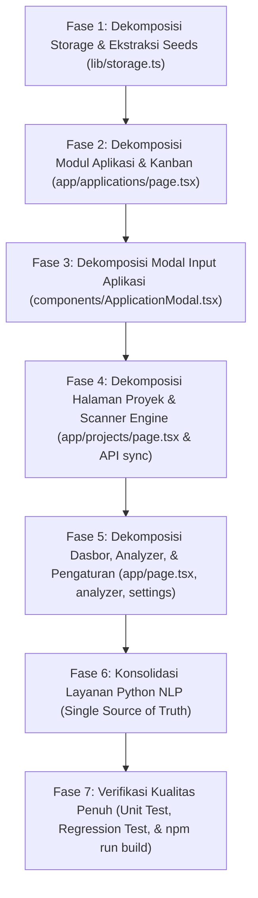

# Masterplan Refactoring Arsitektur & Clean Code: Eliminasi Bulk Lines & Transformasi Arsitektur Berbasis Fitur (Feature-Driven Architecture)

**Tanggal:** 26 Oktober 2026  
**Waktu:** 04:15 WIB  
**Branch:** `refactor`  
**Penulis:** AI Lead Software Architect & Pair Programmer  
**Status:** Draf Arsitektur Disetujui (Approved Blueprint)  
**Dokumen Terkait:**
- [docs/audit/10-25-2026-19-40-backend-logic-and-architecture-audit.md](file:///c:/Users/MyBook%20Hype%20AMD/OneDrive/Documents/kerja/_code/tracker_job/docs/audit/10-25-2026-19-40-backend-logic-and-architecture-audit.md)
- [docs/changelog/feat(backend)/audit/10-26-2026-03-25-feat-backend-audit-resolve-medium-severity-nlp-concurrency-and-logic-flaws.md](file:///c:/Users/MyBook%20Hype%20AMD/OneDrive/Documents/kerja/_code/tracker_job/docs/changelog/feat(backend)/audit/10-26-2026-03-25-feat-backend-audit-resolve-medium-severity-nlp-concurrency-and-logic-flaws.md)

---

## 1. Latar Belakang & Tujuan Refactoring

Pemeriksaan komprehensif terhadap seluruh basis kode proyek menemukan bahwa aplikasi memiliki akumulasi utang teknis (*technical debt*) yang signifikan berupa **file monolitik berukuran raksasa (*God Files*)**, komponen antarmuka yang membengkak (*bloated components*), serta percampuran tanggung jawab (*mixed concerns*). 

Meskipun logika backend dan audit kerentanan telah diselesaikan pada branch `feat/backend-audit`, struktur berkas saat ini masih menyulitkan pemeliharaan, pengujian unit, skalabilitas penambahan fitur, serta berisiko menurunkan performa bundling frontend (*bundle bloat*).

### Tujuan Utama:
1. **Restrukturisasi Arsitektural Bersih:** Bukan sekadar memecah baris kode secara acak, melainkan menyusun kembali arsitektur folder dan berkas menggunakan pola **Feature-Driven Architecture & Separation of Concerns (SoC)** yang lazim pada ekosistem Next.js enterprise.
2. **Eliminasi "God Files":** Menghilangkan file berukuran > 500 baris, membatasi ukuran komponen UI hingga maksimal **100–180 baris**, dan memisahkan data statis (*seed/mock*) ke tempat semestinya.
3. **Pemisahan Lapisan yang Tegas:**
   - **Page Layer (`app/`):** Hanya bertindak sebagai *Thin Controller / Page Coordinator* (~40–60 baris).
   - **Feature Presentation Layer (`features/<feature>/components`):** Komponen UI terisolasi, murni menerima props/hooks.
   - **Feature Logic Layer (`features/<feature>/hooks`):** Mengisolasi state, efek, filter, drag-and-drop, dan mutasi.
   - **Data Access & Storage Layer (`lib/storage/`):** Mengelola persistensi Appwrite Cloud dan LocalStorage secara terpisah per entitas domain.
   - **Data Seed Layer (`data/seeds/`):** Mengisolasi data awal/mock agar tidak membebani memori runtime runtime storage.
   - **Server Service Layer (`server/services/`):** Mengisolasi logika backend Node.js (seperti Git scanner dan file parser) di luar rute API.
   - **NLP Engine Python (`api/services/`):** Menjadikan layanan NLP sebagai *Single Source of Truth* tanpa duplikasi kode pada CLI parser.

---

## 2. Hasil Audit Komprehensif: Peringkat Bulk Lines & Analisis "Code Smells"

Berdasarkan audit otomatis terhadap seluruh berkas kode terlacak Git (36 berkas), berikut adalah peta konsentrasi baris kode proyek:

| Peringkat | Jumlah Baris | Jalur Berkas | Kategori Masalah | Tingkat Urgensi |
| :---: | :---: | :--- | :--- | :---: |
| **1** | **1.975** | [lib/storage.ts](file:///c:/Users/MyBook%20Hype%20AMD/OneDrive/Documents/kerja/_code/tracker_job/lib/storage.ts) | **Extreme God File** (1.800+ baris data mock tercampur logika storage) | **CRITICAL** |
| **2** | **1.334** | [app/applications/page.tsx](file:///c:/Users/MyBook%20Hype%20AMD/OneDrive/Documents/kerja/_code/tracker_job/app/applications/page.tsx) | **Monolithic Page** (Kanban, Table, DnD, Sync, Filter, Modal dalam 1 berkas) | **CRITICAL** |
| **3** | **813** | [app/projects/page.tsx](file:///c:/Users/MyBook%20Hype%20AMD/OneDrive/Documents/kerja/_code/tracker_job/app/projects/page.tsx) | **Monolithic Page** (Project Grid, Table, Filtering, Sync scanner UI) | **HIGH** |
| **4** | **688** | [components/ApplicationModal.tsx](file:///c:/Users/MyBook%20Hype%20AMD/OneDrive/Documents/kerja/_code/tracker_job/components/ApplicationModal.tsx) | **Bloated Modal** (Form multi-input + Drag & drop uploader + Parse preview) | **HIGH** |
| **5** | **565** | [app/page.tsx](file:///c:/Users/MyBook%20Hype%20AMD/OneDrive/Documents/kerja/_code/tracker_job/app/page.tsx) | **Monolithic Dashboard** (Metrics, Funnel chart, Follow-up list, Top projects) | **MEDIUM** |
| **6** | **530** | [app/api/projects/sync/route.ts](file:///c:/Users/MyBook%20Hype%20AMD/OneDrive/Documents/kerja/_code/tracker_job/app/api/projects/sync/route.ts) | **Fat API Route** (Markdown parser, Package.json analyzer, Git scanner di route) | **HIGH** |
| **7** | **465** | [app/analyzer/page.tsx](file:///c:/Users/MyBook%20Hype%20AMD/OneDrive/Documents/kerja/_code/tracker_job/app/analyzer/page.tsx) | **Bloated Page** (Job analyzer form, Gauge chart, Skills match, Letter preview) | **MEDIUM** |
| **8** | **369** | [app/settings/page.tsx](file:///c:/Users/MyBook%20Hype%20AMD/OneDrive/Documents/kerja/_code/tracker_job/app/settings/page.tsx) | **Mixed Concerns** (Profile form, Appwrite credentials, Backup/Restore JSON) | **MEDIUM** |
| **9** | **344** | [api/batch_parser.py](file:///c:/Users/MyBook%20Hype%20AMD/OneDrive/Documents/kerja/_code/tracker_job/api/batch_parser.py) | **Duplicated Logic** (Regex skill, cleaning, dan parser duplikasi dari NLP service) | **MEDIUM** |
| **10** | **329** | [lib/appwrite.ts](file:///c:/Users/MyBook%20Hype%20AMD/OneDrive/Documents/kerja/_code/tracker_job/lib/appwrite.ts) | **Infrastructure Service** (CRUD Project & Application dalam 1 modul) | **LOW** |
| **11** | **315** | [components/ProjectModal.tsx](file:///c:/Users/MyBook%20Hype%20AMD/OneDrive/Documents/kerja/_code/tracker_job/components/ProjectModal.tsx) | **Form Modal** (Form input tags, achievements, validation) | **LOW** |
| **12** | **262** | [components/ProjectDetailModal.tsx](file:///c:/Users/MyBook%20Hype%20AMD/OneDrive/Documents/kerja/_code/tracker_job/components/ProjectDetailModal.tsx) | **Detail Reader Modal** (Preview dokumen proyek, copy text) | **LOW** |
| **13** | **225** | [api/services/analyzer.py](file:///c:/Users/MyBook%20Hype%20AMD/OneDrive/Documents/kerja/_code/tracker_job/api/services/analyzer.py) | **Backend Service** (Match engine + Cover letter prompt builder) | **LOW** |
| **14** | **225** | [app/api/applications/sync/route.ts](file:///c:/Users/MyBook%20Hype%20AMD/OneDrive/Documents/kerja/_code/tracker_job/app/api/applications/sync/route.ts) | **API Route** (Python subprocess executor + Appwrite concurrent syncer) | **LOW** |
| **15** | **208** | [api/services/nlp_engine.py](file:///c:/Users/MyBook%20Hype%20AMD/OneDrive/Documents/kerja/_code/tracker_job/api/services/nlp_engine.py) | **Backend Core NLP** (Pembersih teks, ekstraktor tanggal, portal, skill) | **OK** |

---

## 3. Rincian "Code Smells" & Anti-Pattern Utama

### 1. `lib/storage.ts` — The 2,000-Line Anti-Pattern
* **Masalah:** Dari 1.975 baris, sebanyak **1.850+ baris adalah array statis teks panjang** (`INITIAL_APPLICATIONS` dan `INITIAL_PROJECTS`) yang memuat puluhan paragraf surat lamaran lengkap.
* **Dampak:**
  - Fungsi operasi sebenarnya (`getApplications`, `saveApplication`, dll.) hanya berjumlah ~120 baris di baris terbawah.
  - Setiap kali ada berkas yang mengimpor `saveApplication`, bundler Webpack/Turbopack menyertakan seluruh 1.800 baris mock data ke dalam memory footprint.
* **Solusi Arsitektur:** Pindahkan data mock murni ke `data/seeds/applications.seed.ts` dan `data/seeds/projects.seed.ts`. Pecah operasi ke `lib/storage/application-storage.ts`, `lib/storage/project-storage.ts`, dan `lib/storage/backup-storage.ts`.

### 2. `app/applications/page.tsx` — The Massive God Component
* **Masalah:** Komponen tunggal memuat 15+ state (`useState`), logika sinkronisasi batch, mutasi storage, 5 buah kartu statistik, antrean folder banner, toolbar filter portal, visualisasi papan Kanban 5 kolom dengan Drag-and-Drop native, tabel responsif, dan modal pembaca Cover Letter.
* **Dampak:** Setiap pembaruan state kecil (misal hover drag over kolom) berpotensi memicu re-render pada seluruh komponen pohon tabel dan kartu, menyulitkan debugging serta menutup peluang pengujian unit.
* **Solusi Arsitektur:** Pisahkan ke `features/applications/` yang membagi komponen visual menjadi unit mandiri dengan hooks terdedikasi (`useApplications`, `useApplicationFilters`, `useKanbanDnd`).

### 3. `app/api/projects/sync/route.ts` — The Fat Controller Anti-Pattern
* **Masalah:** Rute API HTTP melakukan tugas di luar perannya: mem-parsing dokumen Markdown (`parseProjectMarkdown`), menganalisis dependency file `package.json`, `composer.json`, `requirements.txt`, membaca commit git lokal, membaca `README.md`, dan melakukan sinkronisasi database cloud.
* **Dampak:** Jika aturan ekstraksi dependensi ingin digunakan di CLI atau skrip lain, kode tidak dapat digunakan kembali (*not reusable*).
* **Solusi Arsitektur:** Ekstraksi seluruh logika pemindaian proyek ke dalam domain service `server/services/project-scanner/` (`markdown-parser.ts`, `tech-detector.ts`, `git-analyzer.ts`). Rute API hanya menjadi pintu masuk HTTP setebal ~30 baris.

### 4. Duplikasi Kode pada Ekosistem Python (`api/`)
* **Masalah:** Aturan ekstraksi keahlian (`extract_skills`), pembersihan nama perusahaan (`clean_company_name`), dan normalisasi judul posisi disalin secara ganda (*code duplication / copy-paste*) di antara `api/services/nlp_engine.py`, `api/batch_parser.py`, dan `api/parse_single.py`.
* **Solusi Arsitektur:** Jadikan `api/services/nlp_engine.py` dan `api/services/pdf_extractor.py` sebagai modul inti (*single source of truth*). Skrip CLI `batch_parser.py` dan `parse_single.py` hanya mengimpor fungsi tersebut.

---

## 4. Blueprint Arsitektur Baru: Target Struktur Folder & Berkas

Berikut adalah arsitektur direktori baru yang rapi, modular, dan memisahkan tanggung jawab secara tegas:

```
tracker_job/
├── app/                                        # NEXT.JS APP ROUTER (Thin Page Controllers Only)
│   ├── (dashboard)/
│   │   └── page.tsx                            # ~45 baris (Hanya menyusun <DashboardView />)
│   ├── analyzer/
│   │   └── page.tsx                            # ~35 baris (Hanya menyusun <AnalyzerView />)
│   ├── applications/
│   │   └── page.tsx                            # ~50 baris (Hanya menyusun <ApplicationsView />)
│   ├── projects/
│   │   └── page.tsx                            # ~40 baris (Hanya menyusun <ProjectsView />)
│   ├── settings/
│   │   └── page.tsx                            # ~35 baris (Hanya menyusun <SettingsView />)
│   ├── api/                                    # THIN API ROUTES (Delegasi ke Server Services)
│   │   ├── applications/
│   │   │   ├── sync/route.ts                   # ~35 baris
│   │   │   └── upload-parse/route.ts           # ~40 baris
│   │   └── projects/
│   │       └── sync/route.ts                   # ~30 baris
│   ├── globals.css
│   └── layout.tsx
│
├── features/                                   # DOMAIN-DRIVEN FEATURE MODULES (UI + Hooks)
│   ├── applications/                           # Modul Aplikasi Lamaran & Kanban
│   │   ├── components/
│   │   │   ├── ApplicationsStats.tsx           # 5 Kartu statistik & progres bar
│   │   │   ├── ApplicationsIngestionBanner.tsx # Banner antrean berkas & batch parse
│   │   │   ├── ApplicationsFilterBar.tsx       # Search bar, filter status & portal chips
│   │   │   ├── ApplicationsTableView.tsx       # Tampilan tabel data lamaran
│   │   │   ├── CoverLetterModal.tsx            # Modal baca dokumen cover letter
│   │   │   ├── ApplicationModal/               # Form modal edit & tambah lamaran
│   │   │   │   ├── ApplicationForm.tsx         # Kolom formulir input data
│   │   │   │   ├── ApplicationParserPanel.tsx  # Panel upload drag-and-drop PDF
│   │   │   │   └── index.tsx                   # Container modal wrapper
│   │   │   └── Kanban/
│   │   │       ├── KanbanBoard.tsx             # Grid 5 kolom kanban
│   │   │       ├── KanbanColumn.tsx            # Dropzone & header kolom status
│   │   │       └── KanbanCard.tsx              # Kartu lamaran, avatar, badge & action
│   │   ├── hooks/
│   │   │   ├── use-applications.ts             # State data lamaran, CRUD & optimistik
│   │   │   ├── use-application-filters.ts      # Query pencarian, filter portal, sorting
│   │   │   └── use-kanban-dnd.ts               # Event drag-and-drop HTML5 & status target
│   │   └── index.ts                            # Export ApplicationsView
│   │
│   ├── projects/                               # Modul Portofolio & Proyek
│   │   ├── components/
│   │   │   ├── ProjectStats.tsx                # Kartu statistik kategori proyek
│   │   │   ├── ProjectFilterBar.tsx            # Filter kategori & search proyek
│   │   │   ├── ProjectGrid.tsx                 # Grid tampilan kartu proyek
│   │   │   ├── ProjectCard.tsx                 # Kartu individual proyek
│   │   │   ├── ProjectTableView.tsx            # Tampilan tabel alternatif proyek
│   │   │   ├── ProjectModal.tsx                # Modal tambah/edit proyek
│   │   │   └── ProjectDetailModal.tsx          # Modal detail preview proyek
│   │   ├── hooks/
│   │   │   ├── use-projects.ts                 # State proyek, CRUD & sync
│   │   │   └── use-project-filters.ts          # Filter kategori & query pencarian
│   │   └── index.ts                            # Export ProjectsView
│   │
│   ├── dashboard/                              # Modul Dasbor Utama & Pipeline
│   │   ├── components/
│   │   │   ├── DashboardMetrics.tsx            # Kartu metrik total proyek & lamaran
│   │   │   ├── ApplicationPipelineBar.tsx      # Distribusi visual pipeline tahapan kerja
│   │   │   ├── FollowUpAlertList.tsx           # Daftar kartu pengingat follow-up
│   │   │   ├── RecentApplicationsCard.tsx      # Widget lamaran terbaru
│   │   │   ├── TopProjectsCard.tsx             # Widget sorotan proyek unggulan
│   │   │   └── DashboardQuickActions.tsx       # Tombol aksi cepat tambah data/prompt
│   │   ├── hooks/
│   │   │   └── use-dashboard-metrics.ts        # Kalkulasi analitik & aggregasi data
│   │   └── index.ts                            # Export DashboardView
│   │
│   ├── analyzer/                               # Modul AI Match & Cover Letter
│   │   ├── components/
│   │   │   ├── JobInputCard.tsx                # Textarea input deskripsi pekerjaan
│   │   │   ├── MatchScoreGauge.tsx             # Indikator skor kecocokan persentase
│   │   │   ├── SkillsMatchBreakdown.tsx        # Perbandingan skill cocok vs kurang
│   │   │   └── CoverLetterGeneratorCard.tsx    # Editor draf cover letter hasil AI
│   │   ├── hooks/
│   │   │   └── use-job-analyzer.ts             # State analisis lowongan & prompt builder
│   │   └── index.ts                            # Export AnalyzerView
│   │
│   └── settings/                               # Modul Pengaturan & Konfigurasi
│       ├── components/
│       │   ├── ProfileSettingsForm.tsx         # Formulir nama, headline, kontak
│       │   ├── AppwriteConfigCard.tsx          # Pengaturan endpoint, key & database
│       │   └── BackupRestoreCard.tsx           # Export & Import data JSON
│       └── index.ts                            # Export SettingsView
│
├── components/                                 # SHARED / REUSABLE UI COMPONENTS
│   ├── ui/                                     # Komponen atom (Button, Badge, Input, Card)
│   ├── Navbar.tsx                              # Header navigasi global aplikasi
│   └── AiPromptModal.tsx                       # Modal panduan prompt AI eksternal
│
├── lib/                                        # CORE INFRASTRUCTURE & SHARED UTILITIES
│   ├── storage/                                # MODULAR DOMAIN STORAGE LAYER
│   │   ├── application-storage.ts              # getApplications, saveApplication, deleteApplication
│   │   ├── project-storage.ts                  # getProjects, saveProject, deleteProject
│   │   ├── profile-storage.ts                  # getUserProfile, saveUserProfile
│   │   ├── backup-storage.ts                   # exportAllDataAsJSON, importAllDataFromJSON
│   │   └── index.ts                            # Barrel export (kompatibel penuh dengan import lama)
│   ├── appwrite.ts                             # Client SDK, validasi ID, sanitasi kapasitas
│   ├── types.ts                                # Definisi tipe TypeScript domain inti
│   ├── constants.ts                            # Konfigurasi konstan, badge styling portal & status
│   └── utils.ts                                # Helper tanggal, inisial nama, warna gradien avatar
│
├── data/                                       # SEED DATA & STATIC ASSETS
│   ├── seeds/
│   │   ├── applications.seed.ts                # Ekstraksi 1.645 baris INITIAL_APPLICATIONS
│   │   └── projects.seed.ts                    # Ekstraksi 210 baris INITIAL_PROJECTS
│   ├── parsed_applications.json                # Hasil ekstraksi berkas resume lokal
│   └── resume/                                 # Direktori arsip PDF surat lamaran
│
├── server/                                     # SERVER-SIDE DOMAIN SERVICES (Node.js API)
│   ├── applications/
│   │   ├── sync.service.ts                     # Orkestrasi batch concurrency ke Appwrite
│   │   └── upload-parse.service.ts             # Sandbox containment & lifecycle temp upload
│   └── projects/
│       ├── markdown-parser.ts                  # Parser sintaks project.md
│       ├── tech-detector.ts                    # Analisis package.json, composer, requirements
│       ├── git-analyzer.ts                     # Ekstraksi riwayat commit & git log
│       └── project-scanner.service.ts          # Pemindaian direktori proyek terpadu
│
└── api/                                        # PYTHON INTELLIGENCE & NLP ENGINE
    ├── models/                                 # Skema Pydantic (ResumeItem, JobAnalysis)
    ├── routers/                                # FastAPI Router Handlers
    ├── services/                               # Service Terpusat (Single Source of Truth)
    │   ├── nlp_engine.py                       # Logika ekstraksi entitas, skill, teks
    │   ├── pdf_extractor.py                    # Ekstraksi teks mandiri berbasis pypdf
    │   ├── analyzer.py                         # Mesin kalkulasi kecocokan & draf surat
    │   └── prompt_builder.py                   # Generator prompt AI
    ├── batch_parser.py                         # CLI Batch Parser (mengimpor dari services)
    ├── parse_single.py                         # CLI Single Parser (mengimpor dari services)
    ├── config.py                               # Konfigurasi kamus keahlian & portal
    └── index.py                                # Entrypoint aplikasi backend FastAPI
```

---

## 5. Rencana Dekomposisi Rinci per God File

### Tahap 1: Dekomposisi [lib/storage.ts](file:///c:/Users/MyBook%20Hype%20AMD/OneDrive/Documents/kerja/_code/tracker_job/lib/storage.ts) (1.975 -> ~60 Baris)
* **Langkah 1.1:** Buat direktori `data/seeds/`.
* **Langkah 1.2:** Pindahkan array `INITIAL_PROJECTS` ke `data/seeds/projects.seed.ts`.
* **Langkah 1.3:** Pindahkan array `INITIAL_APPLICATIONS` ke `data/seeds/applications.seed.ts`.
* **Langkah 1.4:** Buat modul domain storage di `lib/storage/`:
  - `application-storage.ts`: Logika `getApplications()`, `saveApplication()`, `deleteApplication()` dengan referensi seed data.
  - `project-storage.ts`: Logika `getProjects()`, `saveProject()`, `deleteProject()` dengan referensi seed data.
  - `profile-storage.ts`: Logika `getUserProfile()`, `saveUserProfile()`.
  - `backup-storage.ts`: Logika `exportAllDataAsJSON()`, `importAllDataFromJSON()`.
* **Langkah 1.5:** Buat `lib/storage/index.ts` yang mengekspor seluruh fungsi di atas, dan jadikan `lib/storage.ts` sebagai *barrel export* transparan agar tidak merusak impor pada kode yang ada (*100% backwards compatibility*).

---

### Tahap 2: Dekomposisi [app/applications/page.tsx](file:///c:/Users/MyBook%20Hype%20AMD/OneDrive/Documents/kerja/_code/tracker_job/app/applications/page.tsx) (1.334 -> ~50 Baris)
* **Langkah 2.1:** Buat direktori `features/applications/components/` dan `features/applications/hooks/`.
* **Langkah 2.2:** Ekstrak hook logika ke:
  - `hooks/use-applications.ts`: Mengelola pemanggilan data dari storage, fungsi `handleSave`, `handleDelete`, `handleStatusChange` (dengan pembaruan optimistik), serta sinkronisasi metadata resume.
  - `hooks/use-application-filters.ts`: Mengelola input pencarian, filter portal terpilih, toggle follow-up due, toggle cover letter, dan kalkulasi memoized `filteredApps`.
  - `hooks/use-kanban-dnd.ts`: Mengelola state `draggedAppId`, `dragOverCol`, event drag-start/over/leave/drop, dan pemanggilan callback status change.
* **Langkah 2.3:** Ekstrak komponen antarmuka ke:
  - `components/ApplicationsStats.tsx`: Menampilkan 5 kartu metrik (Total Lamaran, Terkirim, Wawancara, Butuh Follow-Up, Progres Berkas).
  - `components/ApplicationsIngestionBanner.tsx`: Menampilkan notifikasi berkas baru di folder `data/resume` beserta tombol trigger batch parse 5/all.
  - `components/ApplicationsFilterBar.tsx`: Menampilkan search box, switch view (Kanban/Table), dan tombol chip filter portal.
  - `components/Kanban/KanbanBoard.tsx`, `KanbanColumn.tsx`, `KanbanCard.tsx`: Komponen visual Kanban yang bersih dan modular.
  - `components/ApplicationsTableView.tsx`: Tabel data lamaran lengkap.
  - `components/CoverLetterModal.tsx`: Modal pembaca cover letter lengkap dengan copy-to-clipboard.
* **Langkah 2.4:** Berkas `app/applications/page.tsx` disederhanakan menjadi pengatur alur tingkat tinggi (*High-Level Coordinator*) dengan panjang di bawah **60 baris**.

---

### Tahap 3: Dekomposisi [components/ApplicationModal.tsx](file:///c:/Users/MyBook%20Hype%20AMD/OneDrive/Documents/kerja/_code/tracker_job/components/ApplicationModal.tsx) (688 -> ~80 Baris)
* **Langkah 3.1:** Pisahkan ke `features/applications/components/ApplicationModal/`:
  - `ApplicationForm.tsx`: Berisi input formulir (perusahaan, posisi, status, tanggal, gaji, link, catatan, keahlian).
  - `ApplicationParserPanel.tsx`: Berisi panel drag-and-drop file PDF lokal, dropdown pilihan berkas `data/resume`, tombol trigger ekstraksi, dan kartu hasil ekstraksi dengan tombol *Terapkan*.
  - `index.tsx`: Modal wrapper yang menghubungkan kedua panel dengan layout grid modal dua kolom yang elegan.

---

### Tahap 4: Dekomposisi [app/projects/page.tsx](file:///c:/Users/MyBook%20Hype%20AMD/OneDrive/Documents/kerja/_code/tracker_job/app/projects/page.tsx) (813 -> ~45 Baris)
* **Langkah 4.1:** Buat direktori `features/projects/components/` dan `features/projects/hooks/`.
* **Langkah 4.2:** Ekstrak hook logika ke:
  - `hooks/use-projects.ts`: State CRUD proyek dan integrasi sinkronisasi scanner lokal.
  - `hooks/use-project-filters.ts`: Filter kategori aktif (SEVIMA, My Produk, Freelance, Thesis, dll.) dan input pencarian.
* **Langkah 4.3:** Ekstrak komponen antarmuka ke:
  - `components/ProjectStats.tsx`: Kartu ringkasan jumlah proyek per kategori.
  - `components/ProjectFilterBar.tsx`: Tab kategori dan search field.
  - `components/ProjectGrid.tsx` & `ProjectCard.tsx`: Grid kartu proyek dengan tags teknologi.
  - `components/ProjectTableView.tsx`: Tampilan tabel alternatif untuk perbandingan proyek.
* **Langkah 4.4:** Jadikan `app/projects/page.tsx` sebagai page coordinator tipis (~45 baris).

---

### Tahap 5: Dekomposisi [app/api/projects/sync/route.ts](file:///c:/Users/MyBook%20Hype%20AMD/OneDrive/Documents/kerja/_code/tracker_job/app/api/projects/sync/route.ts) (530 -> ~35 Baris)
* **Langkah 5.1:** Buat direktori `server/services/projects/`.
* **Langkah 5.2:** Pindahkan fungsi pemrosesan Markdown ke `markdown-parser.ts`.
* **Langkah 5.3:** Pindahkan analisis dependensi `package.json`, `composer.json`, `requirements.txt` ke `tech-detector.ts`.
* **Langkah 5.4:** Pindahkan pembacaan git commit ke `git-analyzer.ts`.
* **Langkah 5.5:** Buat koordinator pemindaian di `project-scanner.service.ts`.
* **Langkah 5.6:** Rute [app/api/projects/sync/route.ts](file:///c:/Users/MyBook%20Hype%20AMD/OneDrive/Documents/kerja/_code/tracker_job/app/api/projects/sync/route.ts) dipangkas menjadi rute tipis yang hanya memanggil service tersebut dan mengembalikan `NextResponse.json(...)`.

---

### Tahap 6: Dekomposisi [app/page.tsx](file:///c:/Users/MyBook%20Hype%20AMD/OneDrive/Documents/kerja/_code/tracker_job/app/page.tsx) (565 -> ~45 Baris)
* **Langkah 6.1:** Buat direktori `features/dashboard/components/`.
* **Langkah 6.2:** Ekstrak widget ke:
  - `DashboardMetrics.tsx`: Statistik total proyek, lamaran terkirim, dan wawancara.
  - `ApplicationPipelineBar.tsx`: Progress bar visual alur seleksi kerja.
  - `FollowUpAlertList.tsx`: Kartu pengingat follow-up (> 7 hari kerja).
  - `RecentApplicationsCard.tsx`: Feed aktivitas lamaran terakhir.
  - `TopProjectsCard.tsx`: Showcase proyek pilihan.
  - `DashboardQuickActions.tsx`: Tombol aksi cepat tambah data & AI generator.

---

### Tahap 7: Konsolidasi Mesin Python NLP (`api/`)
* **Langkah 7.1:** Hapus kode duplikasi regex keahlian dan pembersih nama perusahaan di `api/batch_parser.py` dan `api/parse_single.py`.
* **Langkah 7.2:** Arahkan parsing entitas sepenuhnya ke modul resmi `api/services/nlp_engine.py`.
* **Langkah 7.3:** Hapus atau minimalkan berkas shim `api/nlp_engine.py` yang sudah usang.

---

## 6. Rencana Tahapan Eksekusi (Roadmap Pelaksanaan)

Refactoring akan dilaksanakan secara bertahap (*phased rollout*) untuk memastikan tidak terjadi regresi fungsi pada aplikasi:



| Fase | Fokus Pekerjaan | Berkas Sumber | Target Hasil |
| :---: | :--- | :--- | :--- |
| **Fase 1** | Ekstraksi Data Seed & Pemecahan Storage | `lib/storage.ts` (1.975 baris) | Data mock ke `data/seeds/`, storage modular ke `lib/storage/` (< 80 baris/file) |
| **Fase 2** | Dekomposisi Halaman Aplikasi & Kanban Board | `app/applications/page.tsx` (1.334 baris) | Terpecah ke `features/applications/` dengan hooks & sub-komponen |
| **Fase 3** | Dekomposisi Modal Form & PDF Uploader | `components/ApplicationModal.tsx` (688 baris) | Terbagi menjadi `ApplicationForm` & `ApplicationParserPanel` |
| **Fase 4** | Dekomposisi Halaman Proyek & Scanner Engine | `app/projects/page.tsx` & `api/projects/sync` | Terpecah ke `features/projects/` & `server/services/projects/` |
| **Fase 5** | Modularisasi Dasbor Utama & Analyzer | `app/page.tsx` & `app/analyzer/page.tsx` | Widget modular di `features/dashboard/` & `features/analyzer/` |
| **Fase 6** | Konsolidasi Engine Python NLP (DRY) | `api/batch_parser.py`, `nlp_engine.py` | Eliminasi duplikasi kode fungsi ekstraksi ke `api/services/` |
| **Fase 7** | Pengujian Mutu Menyeluruh | Seluruh aplikasi | Validasi fungsional Kanban DnD, Appwrite, dan `npm run build` (Exit 0) |

---

## 7. Standar Kualitas & Definisi Selesai (Definition of Done)

Setiap tahapan refactoring wajib memenuhi standar rekayasa perangkat lunak berikut:

1. **Ukuran Berkas Terkendali:**
   - Tidak ada lagi berkas di atas **250 baris** (kecuali berkas seed data statis murni di `data/seeds/`).
   - Komponen UI rata-rata berukuran **80–180 baris**.
   - Custom hook rata-rata berukuran **40–120 baris**.
   - Rute API Next.js rata-rata berukuran **25–50 baris**.
2. **Zero Functional Regression (Bebas Kerusakan Fitur):**
   - Fitur native HTML5 Drag-and-Drop pada papan Kanban tetap berjalan mulus.
   - Perubahan status lamaran (via dropdown atau DnD) tetap tersimpan persisten ke LocalStorage dan Appwrite Cloud tanpa revert.
   - Fitur upload & ekstraksi PDF tetap berfungsi aman dengan batas direktori `data/`.
   - Sinkronisasi proyek Git lokal tetap dapat membaca file Markdown dan package manifest.
3. **Penyelarasan Tipe Data (Type Safety):**
   - Menggunakan tipe TypeScript ketat (`JobApplication`, `Project`, `UserProfile`, `ApplicationStatus`) tanpa deklarasi `any` yang tidak perlu.
4. **Verifikasi Kompilasi Bersih:**
   - Menjalankan `npm run build` yang wajib lolos 100% tanpa kesalahan kompilasi (*0 errors, Exit Code 0*).
